# Práctica 3 — Integración de Objetos Inteligentes con Alexa y AWS IoT Core

**Carrera:** Ingeniería de Sistemas

**Docente:** Eduardo Enrique Marin Garcia

**Asignatura:** Internet de las Cosas [SIS-234]

**Semestre:** 2-2026

**Grupo:** 9

**Integrantes:**

- Carlos Eduardo Iriarte Rodriguez
- Isabella Catherine Montes Iñiguez
- Henry Alejandro Rivera Mendez

---

## Índice

1. [Caso de Uso y Requerimientos](#1-caso-de-uso-y-requerimientos)
2. [Análisis y Diseño](#2-análisis-y-diseño)
3. [Desarrollo e Implementación](#3-desarrollo-e-implementación)
4. [Pruebas y Validaciones](#4-pruebas-y-validaciones)
5. [Resultados](#5-resultados)
6. [Conclusiones](#6-conclusiones)
7. [Recomendaciones](#7-recomendaciones)
8. [Anexos](#8-anexos)

---

## 1. Caso de Uso y Requerimientos

### 1.1 Caso de uso

**Problema.** En un parqueo de acceso controlado, la barrera de entrada suele requerir que alguien esté junto a ella (botón, control remoto o guardia). SmartPark permite que un usuario autorizado consulte si hay un vehículo esperando frente a la barrera y que la abra o la cierre **por voz** con Alexa, sin contacto físico con el mecanismo y sin que Alexa se comunique nunca de forma directa con el dispositivo.

**Actores.**

| Actor | Rol |
|---|---|
| Usuario | Persona con una cuenta Alexa. Vincula su parqueo con un PIN temporal y luego consulta datos o da órdenes por voz. |
| Administrador | Operador IAM de la cuenta AWS. Verifica que el usuario esté autorizado y genera el PIN con la Lambda administrativa `SmartParkPairingAdmin`. |
| Objeto inteligente | ESP32 DOIT DevKit V1 registrado como Thing `smartpark-grupo9-01`. Mide la distancia, mueve la barrera y sincroniza su estado con el Device Shadow. |
| Sistema en la nube | Alexa Skills Kit, Lambda `SmartParkAlexaBackend`, AWS IoT Core (Shadow clásico) y DynamoDB (`SmartParkBindings`). |

**Flujo general.**

1. El ESP32 mide la distancia cada 500 ms con el HC-SR04 y publica en `state.reported` del Shadow la distancia, la presencia de vehículo y el estado de la barrera, por evento y con un respaldo periódico de 30 s.
2. El administrador genera un PIN de 4 dígitos para un `userId` de Alexa y un Thing concretos. El PIN vale 300 s y admite 3 intentos.
3. El usuario dice: *"Alexa, abre parqueo inteligente"* y luego *"vincula mi parqueo con el código …"*. La Lambda valida el PIN y guarda la asociación `userId → thingName` en DynamoDB.
4. En sesiones posteriores, la Lambda resuelve el Thing a partir de `context.System.user.userId` sin pedir de nuevo el código.
5. Para consultar (*"consultar distancia"*, *"hay un vehículo esperando"*, *"consultar estado"*), la Lambda lee `state.reported` y responde en español solo si el dato tiene 180 s o menos.
6. Para actuar (*"abrir"*, *"cerrar"*), la Lambda escribe `state.desired.barrera`. AWS IoT calcula el `delta`, el ESP32 lo recibe por MQTT, mueve el servo y confirma en `state.reported.barrera`.

**Multiusuario.** La skill no está atada a un Thing: cada `userId` tiene su propia fila de vinculación y el nombre del Thing nunca se toma de la voz del usuario, sino de DynamoDB. El mismo backend atiende a varios usuarios y varios Things sin cambios de código; solo hay que registrar cada Thing y autorizarlo en las políticas.

**Control solo por voz.** El sensor informa, pero no abre la barrera: el firmware no tiene lógica automática de apertura (la prueba host lo verifica, ver [`test/host/test_main.cpp`](../test/host/test_main.cpp)). La única vía remota para mover la barrera es `desired.barrera`. Por consola serie existen además `OPEN`/`CLOSE` para pruebas de banco.

**Escenario de uso paso a paso** (usuario ya vinculado, dispositivo conectado):

| Paso | Qué ocurre en el mundo físico | Qué ocurre en el sistema | Tiempo característico (según el código) |
|---|---|---|---|
| 1. Llegada | Un vehículo se detiene a menos de 15 cm del HC-SR04 (escala de maqueta). | `measure()` clasifica la lectura como `Present`. La tarea de red espera 3 muestras iguales y publica `vehiculo_detectado: true` (categoría `Sensor`). | 1,0–1,5 s para estabilizar (3 muestras × 500 ms). La presencia confirmada se publica sin esperar la separación mínima de 10 s entre reportes ordinarios. |
| 2. Consulta | El usuario dice *"Alexa, abre parqueo inteligente"* y *"hay un vehículo esperando"*. | La Lambda lee la vinculación en DynamoDB y `reported.vehiculo_detectado` en el Shadow, y comprueba que el dato tenga ≤ 180 s. | Una llamada a DynamoDB y una al Shadow, cada una acotada a 0,5 s de conexión y 1 s de lectura. |
| 3. Orden | El usuario dice *"abrir"*. | La Lambda escribe `desired.barrera = "abierta"` y responde *"Solicité abrir la barrera…"* sin esperar al dispositivo. | Una llamada a DynamoDB y una al Shadow. |
| 4. Ejecución | La barrera sube a 90°. | AWS publica el `delta`, el ESP32 lo encola, `loop()` mueve el servo y, 700 ms después, publica `reported.barrera = "abierta"` (categoría `Control`, sin esperar los 10 s). | 700 ms estimados de recorrido más un ciclo de la tarea (20 ms). |
| 5. Confirmación | El vehículo pasa. | El usuario dice *"consultar estado"* y la Lambda responde con el último `reported.barrera`. | Igual que el paso 2. |
| 6. Cierre | La barrera baja. | *"cerrar"* repite los pasos 3 y 4 con `"cerrada"`. | Igual que los pasos 3 y 4. |

**Límites del sistema.**

| El sistema **sí** | El sistema **no** |
|---|---|
| Mide la distancia y deriva la presencia con histéresis. | Abre ni cierra la barrera por sí solo cuando detecta un vehículo. |
| Mueve la barrera cuando un usuario vinculado lo pide por voz. | Confirma la posición física de la barrera: la **estima** por tiempo (700 ms) y lo indica con `reported.barrera_posicion_estimada`. |
| Informa el último estado reportado y su antigüedad máxima (180 s). | Garantiza que el estado reportado sea el actual si el dispositivo está desconectado: en ese caso responde *"desactualizado"*. |
| Asocia cada cuenta de Alexa con un Thing mediante un PIN temporal. | Autentica a la persona por su voz: quien use la misma cuenta de Alexa tiene los mismos permisos. |
| Sigue midiendo y aceptando órdenes serie sin red. | Detecta obstáculos bajo la barrera ni actúa como dispositivo de seguridad. |

**Restricciones de diseño.** El objeto inteligente trabaja con tensiones de **12 V DC o menos** (todo el montaje funciona a 5 V y 3,3 V). El actuador debe producir un **efecto mecánico**, así que no se usan LEDs como actuador. La barrera se controla **solo por voz** y la skill es **multiusuario**: no hay un Thing fijo en el código.

### 1.2 Justificación del sensor y del actuador

| Componente | Tipo | Variable / acción | Alimentación | Interfaz con el ESP32 |
|---|---|---|---|---|
| HC-SR04 | Sensor ultrasónico de distancia | Distancia al objeto (cm) y presencia derivada | 5 V | TRIG → GPIO 32 · ECHO → divisor 1 kΩ/2 kΩ → GPIO 35 |
| SG90 | Servomotor de posición | Barrera cerrada (0°) / abierta (90°) | 5 V desde fuente externa | Señal PWM 50 Hz → GPIO 18 |

**Por qué un sensor ultrasónico.** El caso de uso necesita saber si hay un vehículo **frente a la barrera, sin contacto** y a cierta distancia del mecanismo. El HC-SR04 entrega una distancia continua (2–400 cm según la configuración del firmware) y de ella se deriva la presencia con un umbral (15 cm) y una histéresis (3 cm). Tener la distancia, y no solo un sí/no, aporta tres cosas:

- Permite responder dos consultas distintas: *distancia* y *vehículo esperando*.
- Permite ajustar el umbral de detección por configuración, sin cambiar hardware.
- Permite reportar por cambio significativo (≥ 10 cm) en lugar de cada lectura.

Las alternativas no cubren el caso:

- **Interruptor magnético (reed):** necesita un imán montado en el vehículo y solo detecta contacto o proximidad de pocos milímetros. No sirve para vehículos arbitrarios.
- **Sensor IR binario:** entrega solo presencia/ausencia, con un umbral fijado por potenciómetro. No permite consultar distancia ni ajustar el umbral desde el código, y depende más del color y de la luz ambiente.
- **Final de carrera o lazo inductivo:** requieren contacto físico o una instalación en el piso que no corresponde a un prototipo de banco.

**Comparación de sensores candidatos** (características generales; los valores numéricos de cada modelo deben tomarse de su hoja de datos):

| Sensor | Magnitud que mide | Rango típico | ¿Contacto? | Costo relativo | Interfaz con el ESP32 | Adecuación al caso |
|---|---|---|---|---|---|---|
| **HC-SR04 (ultrasónico)** | Tiempo de vuelo de un eco → distancia | Centímetros a pocos metros | No | Bajo | 2 GPIO digitales (TRIG y ECHO, con adaptación de 5 V a 3,3 V) | **Alta:** distancia continua, umbral configurable y bajo costo. |
| Sensor IR de proximidad | Reflexión infrarroja (umbral o tensión analógica) | Centímetros | No | Bajo | 1 GPIO digital o 1 entrada ADC | Media: el modelo binario no da distancia, y la reflexión depende del color y de la luz ambiente. |
| Reed switch | Campo magnético (abierto o cerrado) | Milímetros | Requiere un imán en el objeto | Muy bajo | 1 GPIO digital | Baja: exige modificar cada vehículo. |
| Lazo inductivo | Cambio de inductancia por la masa metálica | Superficie del lazo | No, pero se instala en el piso | Alto | Requiere un detector dedicado | Baja para un prototipo de banco. |
| LiDAR de bajo costo (ToF) | Tiempo de vuelo óptico → distancia | Decímetros a metros | No | Medio | I²C o UART | Media: más preciso y de haz más estrecho, pero con más costo e integración. |

**Comparación de actuadores candidatos:**

| Actuador | Movimiento | Control de posición | Alimentación y driver | Adecuación al caso |
|---|---|---|---|---|
| **SG90 (servomotor)** | Rotación angular limitada | Lazo cerrado **interno** del servo; sin realimentación hacia el ESP32 | 5 V; PWM directo desde un GPIO, sin driver | **Alta:** dos posiciones discretas (0° y 90°) con una sola señal. |
| Motor DC con driver (puente H) | Rotación continua | Ninguno sin encoder o finales de carrera | Driver más fuente; 2 o 3 GPIO | Media: necesita sensores de fin de recorrido para saber dónde parar. |
| Solenoide | Lineal, todo o nada | Dos estados por diseño | Transistor o relé, diodo de rueda libre y fuente de mayor corriente | Baja: carrera corta y consumo sostenido para mantener una posición. |

> ⏳ **PENDIENTE (manual):** adjuntar las hojas de datos del HC-SR04 y del SG90 en `docs/datasheets/`, para respaldar los valores de rango, ángulo, resolución y alimentación que se citan — descargarlas del fabricante o del distribuidor del módulo usado.

**Por qué un SG90.** La barrera tiene **dos estados discretos** (cerrada y abierta) que el SG90 alcanza por ángulo (0° y 90°) sin lógica de control adicional. Funciona a 5 V, dentro de la restricción de diseño de 12 V DC o menos; no es un LED ni maneja cargas de 220 V AC. Se alimenta desde una **fuente externa regulada de 5 V con tierra común**, nunca desde el pin de 3,3 V ni desde un GPIO.

**Limitación declarada.** El SG90 no informa su posición. El firmware **estima** que el movimiento terminó 700 ms después de la orden (`SERVO_TRAVEL_MS`) y recién entonces confirma en `reported`. Si la varilla se bloquea, `reported` puede indicar *abierta* sin que la barrera lo esté. Esto se analiza en 2.3.1 y 7.2.

### 1.3 Requerimientos funcionales

| ID | Requerimiento | Cómo se cumple | Implementación |
|---|---|---|---|
| RF1 | Capturar datos con el sensor | Medición cada 500 ms con espera acotada de 30 ms. Clasifica la lectura en válida, timeout o fuera de rango y deriva la presencia con histéresis. | [`UltrasonicSensor::measure()`](../src/UltrasonicSensor.cpp#L11) |
| RF2 | Reportar periódicamente el sensor y el estado del actuador en `reported` | Reporte por evento (Δ ≥ 10 cm, cambio de presencia o validez) y respaldo cada 30 s. Siempre publica los tres atributos de estado y `barrera_posicion_estimada: true`. | [`AwsIoTManager::step()`](../src/AwsIoTManager.cpp#L265), [`report()`](../src/AwsIoTManager.cpp#L244) |
| RF3 | Recibir `delta`, aplicarlo al actuador y confirmar en `reported` | Suscripción a `update/delta`. `receive()` → `applyDesired()` → cola → `tick()` → `BarrierServo` → `report(Control)`. | [`receive()`](../src/AwsIoTManager.cpp#L192), [`applyDesired()`](../src/AwsIoTManager.cpp#L178), [`tick()`](../src/AwsIoTManager.cpp#L18) |
| RF4 | Responder en español consultas del sensor leyendo `reported` del Thing vinculado | `GetThingShadow` y lectura de `state.reported.<campo>` con control de frescura de 180 s. | [`ConsultarDistanciaHandler`, `ConsultarVehiculoHandler`](../lambda/handlers/sensor_handlers.py), [`ShadowService.get_reported`](../lambda/services/shadow_service.py#L30) |
| RF5 | Ejecutar comandos de voz modificando `desired` | `UpdateThingShadow` con `{"state":{"desired":{"barrera":…}}}`, sin lectura previa ni espera activa. | [`AbrirBarreraHandler`, `CerrarBarreraHandler`](../lambda/handlers/barrier_handlers.py), [`ShadowService.set_barrier`](../lambda/services/shadow_service.py#L61) |
| RF6 | Responder el estado del actuador | Lee `reported.barrera` y valida que sea `abierta` o `cerrada`. | [`EstadoBarreraHandler`](../lambda/handlers/barrier_handlers.py#L27) |
| RF7 | Vincular el objeto con persistencia entre sesiones | Fila `userId → thingName` en DynamoDB, creada por una transacción que consume el PIN. | [`VincularParqueoHandler`](../lambda/handlers/binding_handlers.py#L6), [`DynamoDBService.save_binding`](../lambda/services/dynamodb_service.py#L107) |
| RF8 | Resolver el Thing por `context.System.user.userId` y guiar si no hay vinculación | `bound_device()` lee la vinculación del usuario del contexto. Si no existe, explica cómo vincular. | [`handlers/common.py`](../lambda/handlers/common.py#L13), [`LaunchHandler`](../lambda/handlers/system_handlers.py#L12) |
| RF9 | Validar que el Thing exista antes de vincular y permitir cambiar o eliminar la vinculación | `DescribeThing` al generar el PIN y otra vez al vincular. `CambiarVinculacionIntent` reemplaza con condición de revisión. `DesvincularParqueoIntent` borra la fila. | [`ShadowService.describe_thing`](../lambda/services/shadow_service.py#L19), [`CambiarVinculacionHandler`, `DesvincularParqueoHandler`](../lambda/handlers/binding_handlers.py#L30) |

**Criterios de aceptación.** Cada RF se da por cumplido cuando se observa lo siguiente:

| ID | Criterio de aceptación (qué se observa) | Prueba de banco o de extremo a extremo | Prueba automática |
|---|---|---|---|
| RF1 | El monitor serie muestra `Distancia: X cm` cada 500 ms. Con un objeto a 10 cm indica `Vehiculo detectado: SI`, y al tapar el sensor indica `invalida (timeout)` o `invalida (fuera de rango)`. | PF-01, PNF-02 | `test_main.cpp` (conversión, timeout, fuera de rango e histéresis) |
| RF2 | En el cliente de prueba MQTT llega un `update/accepted` con el `clientToken` del ESP32 y los tres atributos de estado junto con `barrera_posicion_estimada: true`: en reposo cada ≈ 30 s, ≤ 10 s después de un cambio de ≥ 10 cm y, tras un cambio de presencia estable, sin esperar la separación mínima. | PF-03, PNF-01 | `test_aws.cpp` (distancia, presencia, periodo) |
| RF3 | Tras escribir `desired.barrera`, el servo se mueve una sola vez y `reported.barrera` toma el mismo valor, sin que quede `delta`. | PF-04, PF-05, pruebas automáticas (sección 4) | `test_aws.cpp` (comandos, espera de 700 ms, versiones) |
| RF4 | La respuesta hablada coincide con el valor de `reported` del Thing del usuario. Con un dato de más de 180 s, responde *"desactualizado"*. | PF-03, PF-06, pruebas automáticas (sección 4) | `test_valid_distance_reported_not_desired`, `test_presence_true_and_false`, `test_stale_per_field_even_when_document_is_new` |
| RF5 | Tras *"abrir"*, el Shadow tiene `desired.barrera = "abierta"`, la respuesta empieza por *"Solicité abrir"* y no hay ninguna lectura previa del Shadow. | PF-04, PF-05 | `test_open_and_close_only_desired` |
| RF6 | *"consultar estado"* repite el valor de `reported.barrera`, y con un valor desconocido responde con un error. | PF-06 | `test_barrier_state_reported`, `test_unknown_barrier_state` |
| RF7 | Después de vincular, al cerrar y reabrir la skill, la bienvenida ofrece *"abrir, consultar estado, cerrar o salir"* y DynamoDB tiene la fila del usuario. | PF-07, PF-08, pruebas automáticas (sección 4) | `test_valid_binding_and_one_use_code`, `test_parallel_correct_consumption_succeeds_once` |
| RF8 | Un usuario sin vinculación recibe la instrucción de vincularse y ninguna operación sobre el Shadow. | PF-07, pruebas automáticas (sección 4) | `test_launch_unbound`, `test_no_binding_for_controls_or_queries` |
| RF9 | Un PIN para un Thing inexistente no se genera. Cambiar reemplaza el Thing y desvincular borra la fila. | Pruebas automáticas (sección 4) | `test_existing_thing_required`, `test_change_binding`, `test_unbind_one_delete_no_get` |

### 1.4 Requerimientos no funcionales

Cada RNF tiene un valor declarado verificable y una prueba asociada (sección 4.2). Los valores marcados como **propuesta** deben ser confirmados por el grupo antes de medir.

| ID | Atributo | Valor declarado | Justificación | Prueba |
|---|---|---|---|---|
| RNF1 | Estabilidad | ≥ 10 min de funcionamiento continuo sin reinicio ni bloqueo, con MQTT conectado. Objetivo de prueba: 60 min, la duración completa de la demo. | 10 min cubren una sesión de uso con varias llegadas, consultas y órdenes, y dejan pasar al menos 20 respaldos periódicos de 30 s. El firmware limita la sesión a 60 min conectados (`AWS_DEMO_MAX_CONNECTED_MS`), así que esa es la ventana natural de prueba. | PNF-01 |
| RNF2 | Exactitud de medición | **Propuesta:** error absoluto máximo ≤ 1 cm en el rango de trabajo de 5 a 50 cm. | El umbral de presencia es de 15 cm con 3 cm de histéresis: un error menor que la histéresis evita clasificar mal la presencia. El rango cubre el umbral con margen en una maqueta de banco. Por debajo de 5 cm el sensor se acerca a su distancia mínima (2 cm), y por encima de 50 cm el cono del haz capta objetos laterales del banco. La hoja de datos del HC-SR04 indica un ángulo efectivo de unos 15° y una resolución de alrededor de 0,3 cm. | PNF-02 |
| RNF3 | Tiempo de respuesta | ≤ 3 s desde el fin de la frase del usuario hasta que el servo termina el recorrido estimado (Alexa → Lambda → Shadow → ESP32). | En una conversación, una espera de más de unos pocos segundos tras la respuesta de Alexa hace que el usuario repita la orden. El recorrido del servo aporta 700 ms estimados, y la Lambda no hace lecturas previas ni esperas activas, así que, descontando también ≈ 0,1 s de la tarea de red y de `loop()` (estimación), quedan ≈ 2,2 s para la voz, la nube y la red. | PNF-03 |
| RNF4 | Frecuencia de reporte | Por evento: Δ distancia ≥ 10 cm o cambio de validez, con separación mínima de 10 s; cambio de presencia (estable 3 muestras), sin esperar esa separación. Control: confirmación inmediata tras 700 ms. Respaldo periódico: 30 s. Intervalo máximo entre reportes con conexión y cuota disponibles: **30 s**. | Dinámica de la variable: un vehículo de maqueta se acerca en segundos, y la presencia es un evento discreto, por eso no espera la separación mínima. Los 10 s y los 30 s protegen la cuota (2.6). La Lambda acepta datos de hasta 180 s, es decir, tolera hasta 5 respaldos perdidos seguidos: con 5 perdidos, el dato llega a (5 + 1) × 30 s = 180 s justo cuando se recibe el siguiente. | PNF-01 (conteo de UPDATE), pruebas automáticas (sección 4) |
| RNF5 | Reconexión y sincronización | Reconexión automática Wi-Fi y MQTT con backoff exponencial de 5 s a 5 min con *jitter*, máximo 10 intentos consecutivos; el contador vuelve a 0 tras un GET válido. Al reconectar, un único GET aplica el `desired` pendiente. **Propuesta:** con un corte de red ≤ 30 s, el `desired` pendiente se aplica y se confirma en `reported` en ≤ 60 s después de restaurar la red. | Evita tormentas de reconexión y gasto de cuota. El GET recupera órdenes dadas mientras el dispositivo estaba desconectado. | PNF-04 |
| RNF6 | Consumo de mensajes | ≤ 1000 solicitudes Shadow (GET + UPDATE) por día UTC y por dispositivo, contadas en NVS. Los reportes ordinarios se detienen en 800; las 200 restantes quedan reservadas para control y para el GET de recuperación. Sesión de demo ≤ 60 min conectados. | Protege la capa gratuita (2.6). El contador es una cota conservadora de intentos, no una medición de facturación. | Pruebas automáticas (sección 4) |
| RNF7 | Seguridad | Sin certificados, claves, Wi-Fi ni *access keys* en el repositorio. MQTT sobre TLS con X.509. Políticas IoT e IAM limitadas al Thing y a la tabla. PIN de un solo uso, 300 s y 3 intentos. Solicitudes Alexa validadas por Skill ID y antigüedad ≤ 150 s. | El actuador mueve un objeto físico: una credencial filtrada o una política amplia permitirían mover la barrera de otro usuario. TLS mutuo autentica a ambos extremos, las políticas acotan el daño de una credencial comprometida y la antigüedad máxima limita la reutilización de una solicitud capturada. | Pruebas automáticas (sección 4) y verificación estática (sección 4.2) |
| RNF8 | Calidad de código | POO modular, comentarios en las decisiones no obvias, compilación host con `-Wall -Wextra -Werror -pedantic` y pruebas automáticas del firmware y de la Lambda. | La lógica de cuota, reconexión, vinculación y concurrencia es difícil de probar en el banco. Las pruebas con dobles la ejercitan en segundos y sin consumir AWS, y `-Werror` impide que una advertencia del compilador llegue al firmware. | Pruebas automáticas (sección 4) |

**Medición, justificación técnica y riesgo de cada RNF.**

| ID | Cómo se mide | Por qué ese valor | Riesgo si no se cumple |
|---|---|---|---|
| RNF1 | Monitor serie con marcas de tiempo. El banner de arranque no debe reaparecer y `STATUS` muestra `reconexiones=0`. | Supera varias veces el respaldo de 30 s y el timeout de 15 s del Shadow, así que expone fugas de memoria o bloqueos acumulativos de la tarea de red. | Reinicios que consumen GET de recuperación e intentos de conexión (10 consecutivos sin un GET válido). Si se agotan, el dispositivo queda solo en modo local. |
| RNF2 | Cinta métrica y 5 lecturas por distancia (PNF-02); error absoluto máximo. | La banda de histéresis mide 3 cm: un error menor que 1 cm mantiene cada lectura del lado correcto del umbral salvo en una franja de ±1 cm junto a 15 y 18 cm. | Presencias falsas o perdidas y reportes `Sensor` innecesarios que consumen cuota. |
| RNF3 | Video a ≥ 30 fps con el simulador y el servo en el mismo cuadro (PNF-03). | Coincide con el tiempo que un usuario espera tras una respuesta de voz antes de repetir la orden. | El usuario repite la orden. Como el diseño consolida órdenes iguales, no hay doble movimiento, pero sí más invocaciones y lecturas. |
| RNF4 | Cliente de prueba MQTT y contadores de `STATUS` (PNF-01). | 30 s mantienen los datos dentro de la ventana de 180 s de la Lambda aunque se pierdan hasta 5 respaldos seguidos. 10 s acotan la cuota (2.6). | Con intervalos mayores, la skill responde *"desactualizado"*. Con intervalos menores, se agota la cuota ordinaria antes de terminar la demo. |
| RNF5 | Corte controlado del punto de acceso (PNF-04). | El GET de reconexión es la única vía para recuperar una orden dada sin conexión, porque el `delta` no se reenvía. | Órdenes perdidas o aplicadas tarde. Un backoff mal acotado agota los 10 intentos consecutivos o genera tormentas de reconexión. |
| RNF6 | Cálculo de 2.6 y pruebas automáticas de `ShadowBudget` (sección 4); `STATUS` muestra `solicitudesTotales`. | 1000 solicitudes alcanzan para una demo de 60 min con margen (2.6) y reservan 200 para confirmar órdenes y para el GET de recuperación. | Gasto no previsto en la cuenta o, en el extremo opuesto, que se pierda la confirmación de las órdenes. |
| RNF7 | Búsqueda estática en Git (sección 4.2) y pruebas automáticas (sección 4). | Las credenciales X.509 identifican al dispositivo ante AWS: si se filtran, otro cliente puede hacerse pasar por él. | Suplantación del dispositivo, órdenes de terceros o publicación de credenciales en GitHub. |
| RNF8 | Ejecución de las tres suites (pruebas automáticas, sección 4). | 0 *warnings* y 100 % PASS es el único umbral que no deja errores conocidos sin resolver. | Regresiones no detectadas en la lógica de cuota o de vinculación, que en el banco son lentas y caras de reproducir. |

---

## 2. Análisis y Diseño

### 2.1 Diagrama de arquitectura

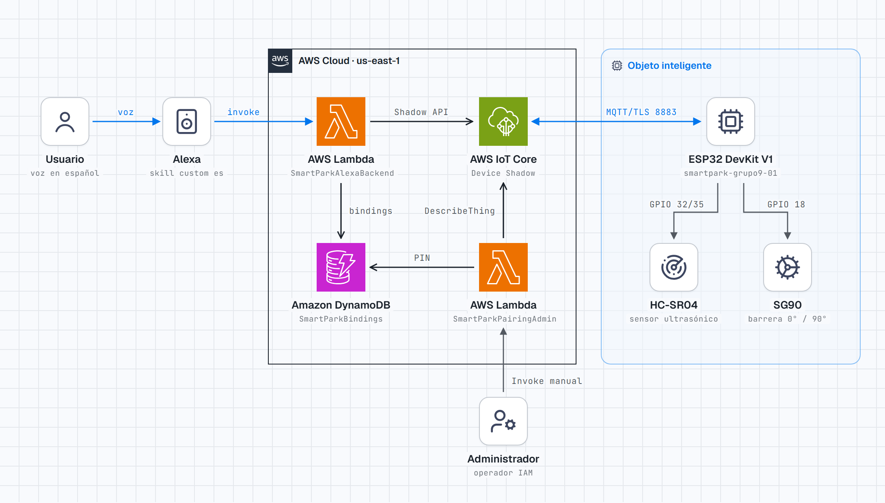

*Figura 1. Arquitectura de despliegue de SmartPark.*

El mismo diagrama en Mermaid, con el detalle de las operaciones de cada flujo:

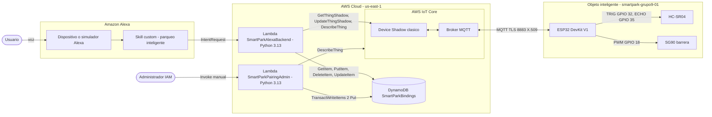

**Flujos.**

| Flujo | Recorrido | Protocolo / API |
|---|---|---|
| Telemetría | HC-SR04 → ESP32 → `$aws/things/smartpark-grupo9-01/shadow/update` → `state.reported` | MQTT sobre TLS, puerto 8883, autenticación mutua X.509 |
| Consulta por voz | Usuario → Alexa → Lambda → DynamoDB (`GetItem` de la vinculación) → IoT Data (`GetThingShadow`) → respuesta hablada | HTTPS (SDK boto3) |
| Comando por voz | Usuario → Alexa → Lambda → DynamoDB → IoT Data (`UpdateThingShadow` sobre `desired`) → AWS calcula el `delta` → MQTT `update/delta` → ESP32 → servo → `reported` | HTTPS + MQTT |
| Vinculación | Administrador → `SmartParkPairingAdmin` (`DescribeThing` + transacción en DynamoDB) → PIN → Usuario → Alexa → Lambda (validación + transacción de 3 acciones) | Invocación IAM + HTTPS |

Alexa **nunca** se comunica con el ESP32: la Lambda solo conoce el Shadow, y el ESP32 solo conoce sus temas MQTT del Shadow. El Shadow desacopla los dos lados: si el dispositivo está desconectado, la orden queda en `desired` y se aplica al reconectar (2.4.3).

**Componentes de la arquitectura.**

| Componente | Tecnología | Responsabilidad | Interfaces | Ubicación en el repositorio |
|---|---|---|---|---|
| Objeto inteligente | ESP32 DOIT DevKit V1, Arduino-ESP32 sobre FreeRTOS | Medir la distancia, mover la barrera, reportar en `reported` y aplicar el `delta` | GPIO hacia el HC-SR04 y el SG90; MQTT/TLS hacia AWS IoT; consola serie a 115 200 baudios | [`src/`](../src/), [`include/`](../include/) |
| Registro y Shadow | AWS IoT Core (Thing, certificado, política y Shadow clásico) | Autenticar el dispositivo, guardar el último `reported`/`desired` y calcular el `delta` | Broker MQTT (dispositivo) y API HTTPS de IoT Data (Lambda) | [`docs/aws-iot-policy.example.json`](aws-iot-policy.example.json) |
| Skill | Alexa Skills Kit, modelo *custom* en español | Reconocer intents y el slot `codigo`, e invocar la Lambda | Solicitudes y respuestas JSON de ASK | Modelo de interacción ⏳ PENDIENTE (3.3) |
| Backend de la skill | AWS Lambda `SmartParkAlexaBackend`, Python 3.13 y ASK SDK 1.19.0 | Validar la solicitud, resolver la vinculación, leer `reported` y escribir `desired` | Disparador de Alexa Skills Kit; boto3 hacia DynamoDB, IoT e IoT Data | [`lambda/lambda_function.py`](../lambda/lambda_function.py), [`handlers/`](../lambda/handlers/), [`services/`](../lambda/services/) |
| Generador de PIN | AWS Lambda `SmartParkPairingAdmin`, Python 3.13 y boto3 | Crear la ventana de intentos y la autorización del PIN | Invocación manual con IAM; boto3 hacia DynamoDB e IoT | [`lambda/admin_lambda_function.py`](../lambda/admin_lambda_function.py), [`administration/`](../lambda/administration/) |
| Persistencia | Amazon DynamoDB, tabla `SmartParkBindings` | Vinculaciones, autorizaciones de PIN y ventanas de intentos | API HTTPS de DynamoDB (`GetItem`, `UpdateItem`, `DeleteItem`, `TransactWriteItems`) | Definición real ⏳ PENDIENTE (3.2.5) |

**Protocolos y puertos.**

| Enlace | Protocolo | Puerto | Autenticación | Detalle en el código |
|---|---|---|---|---|
| ESP32 ↔ AWS IoT Core | MQTT sobre TLS (cliente PubSubClient 2.8) | 8883 | Mutua con X.509: el dispositivo verifica a AWS con Amazon Root CA 1 y AWS verifica el certificado del dispositivo | `MQTT_PORT 8883`, `setCACert`, `setCertificate` y `setPrivateKey` en [`run()`](../src/AwsIoTManager.cpp#L75). Keepalive de 120 s y timeout de *handshake* de 5 s. |
| ESP32 → servidores NTP | NTP (UDP) | 123 | Ninguna | `configTime(0, 0, "pool.ntp.org", "time.cloudflare.com")` en [`connectStep()`](../src/AwsIoTManager.cpp#L142) |
| Alexa → Lambda | Invocación de Lambda desde el servicio Alexa | — (interna de AWS) | Disparador de Alexa Skills Kit restringido al Skill ID, más la comprobación de `applicationId` en el código | [`lambda_handler()`](../lambda/lambda_function.py#L30) |
| Lambda → IoT Data | HTTPS (API REST del Shadow) | 443 | Firma SigV4 con el rol de ejecución | `boto3.client("iot-data", endpoint_url=…)` en [`runtime.py`](../lambda/services/runtime.py#L50) |
| Lambda → IoT (plano de control) | HTTPS (`DescribeThing`, `DescribeEndpoint`) | 443 | SigV4 con el rol de ejecución | [`runtime.py`](../lambda/services/runtime.py#L43) |
| Lambda → DynamoDB | HTTPS | 443 | SigV4 con el rol de ejecución | [`runtime.py`](../lambda/services/runtime.py#L42) |

El puerto 443 de los enlaces HTTPS es el valor por defecto de los clientes boto3; el código no lo fija explícitamente.

**Extensibilidad.** Un sensor nuevo se integra sin rediseñar la arquitectura:

1. En el firmware: una clase de dispositivo con la misma forma que `UltrasonicSensor`, un campo más en `Snapshot` y un atributo más en `report()`.
2. En el Shadow: un atributo nuevo en `reported`.
3. En la Lambda: un `IntentHandler` nuevo que llama a `ShadowService.get_reported(thing, "<campo>")`.

Las políticas, la vinculación y los temas MQTT no cambian. Un actuador nuevo se agrega como otro atributo en `desired` y otra rama en `applyDesired()`.

### 2.2 Diagrama de circuito

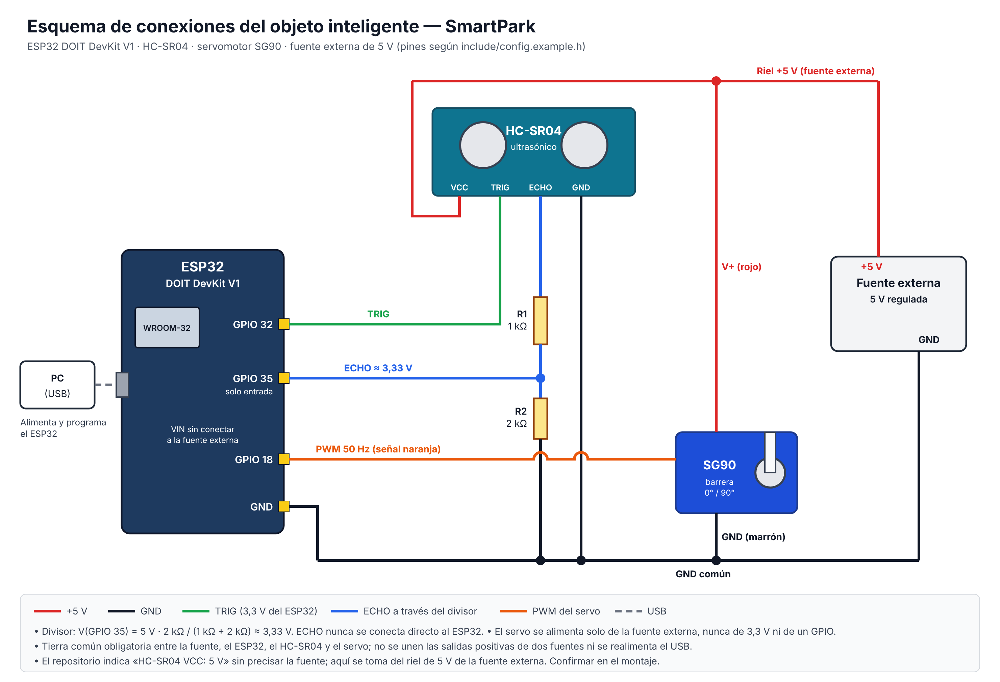

*Figura 2. Esquema de conexiones de SmartPark.*

> ⏳ **PENDIENTE (manual):** el repositorio indica "HC-SR04 VCC: 5 V" sin precisar la fuente. El esquema lo toma del riel de 5 V de la fuente externa; confirmar en el montaje y corregir la figura si el sensor se alimenta desde el pin VIN/5V del DevKit.

**Tabla de conexiones** (verificada contra [`include/config.example.h`](../include/config.example.h) y [`README.md`](../README.md)):

| Componente | Pin del componente | Conexión | Nota |
|---|---|---|---|
| HC-SR04 | VCC | 5 V | El módulo trabaja a 5 V. |
| HC-SR04 | GND | Tierra común | |
| HC-SR04 | TRIG | GPIO 32 | Salida de 3,3 V del ESP32. Se espera que el HC-SR04 la reconozca como nivel alto; ⏳ confirmar en banco. |
| HC-SR04 | ECHO | 1 kΩ → **GPIO 35** → 2 kΩ → GND | GPIO 35 es solo entrada y no tiene pull-up/pull-down internos. |
| SG90 | Señal | GPIO 18 | PWM 50 Hz. Rango de pulso de 500 a 2400 µs (`SERVO_MIN_US` y `SERVO_MAX_US`): 0° = 500 µs y 90° = 1450 µs, enviados con `writeMicroseconds()`. |
| SG90 | V+ | +5 V de una fuente externa regulada | Nunca desde 3,3 V ni desde un GPIO. |
| SG90 | GND | GND de la fuente **y** GND del ESP32 | Tierra común obligatoria para que la señal PWM tenga referencia. |

**Divisor de tensión para ECHO.** El pin ECHO entrega 5 V y el ESP32 trabaja con 3,3 V en sus entradas:

$$V_{GPIO35} = V_{ECHO}\cdot\frac{R_2}{R_1+R_2} = 5\,\text{V}\cdot\frac{2\,\text{k}\Omega}{1\,\text{k}\Omega+2\,\text{k}\Omega} \approx 3{,}33\,\text{V}$$

La corriente del divisor es de unos 5 V / 3 kΩ ≈ 1,7 mA. Con resistencias del 5 %, en el peor caso (R1 = 0,95 kΩ y R2 = 2,1 kΩ) la tensión sube a unos 3,44 V, cerca del límite. Por eso el README pide medir el nivel real antes de conectar.

**Advertencias eléctricas.**

- El servo genera picos de corriente al arrancar o al bloquearse: hay que dimensionar la fuente de 5 V para esos picos y no alimentarlo desde el USB del ESP32.
- No se unen las salidas de dos fuentes distintas; solo se unen las tierras.
- Primero se prueba el servo sin varilla ni carga, calibrando el recorrido para evitar topes y sobrecorriente.
- El montaje es una prueba de banco y no un controlador de seguridad: no detecta obstáculos bajo la barrera.

**Diagrama eléctrico funcional**

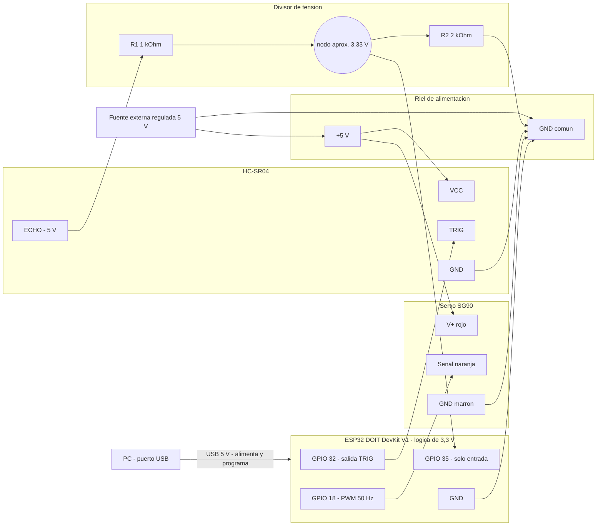

El diagrama separa los dos dominios de alimentación: el ESP32 se alimenta por USB y la fuente externa alimenta el riel de 5 V del sensor y del servo, sin unir sus salidas positivas. La única unión entre ambos dominios es la **tierra común**, imprescindible para que el PWM de GPIO 18 y el TRIG de GPIO 32 tengan la misma referencia que los módulos. La señal ECHO, de 5 V, solo llega a GPIO 35 a través del divisor R1/R2. La alimentación del HC-SR04 sigue el mismo supuesto que la Figura 2 y queda sujeta al mismo PENDIENTE.

**Análisis de consumo eléctrico.** Lo que puede afirmarse sin medir es lo siguiente:

| Rama | Valor | Origen |
|---|---|---|
| Divisor de ECHO, con ECHO en alto | 5 V / (1 kΩ + 2 kΩ) ≈ 1,7 mA, solo mientras dura el pulso de eco | Calculado con R1 y R2 |
| Divisor de ECHO, con ECHO en bajo | ≈ 0 mA | Calculado |
| Ciclo de trabajo del eco | Ancho del pulso ≤ 30 ms (`ECHO_TIMEOUT_US`) cada 500 ms (`SENSOR_INTERVAL_MS`), es decir, ≤ 6 % | `config.example.h` |
| Pulso de disparo TRIG | 10 µs en alto por medición (`TRIG_HIGH_US`) | `config.example.h` |
| Servo SG90 | Pico al arrancar o al bloquearse; consumo bajo en reposo con la posición mantenida | Comportamiento general de un servo; sin valor numérico en el repositorio |

> ⏳ **PENDIENTE (manual):** medir con un multímetro en serie la corriente del riel de 5 V (reposo, servo en movimiento y servo bloqueado con la mano, sin varilla) y la del USB del ESP32 (Wi-Fi conectado y transmitiendo), y dimensionar la fuente con el pico medido más un margen.

### 2.3 Diagramas de clases

#### 2.3.1 Objeto inteligente (firmware ESP32)

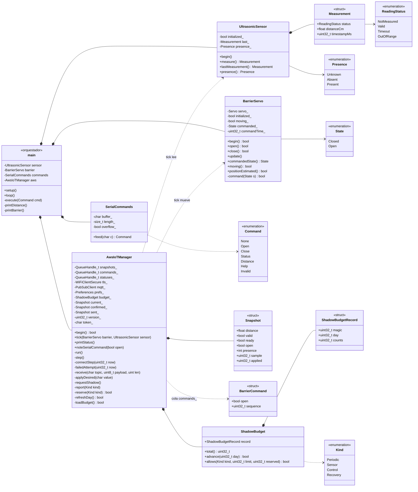

*`Measurement`, `ReadingStatus` y `Presence` están anidados en `UltrasonicSensor`; `State`, en `BarrierServo`; `Command`, en `SerialCommands`. `BarrierCommand` es `AwsIoTManager::Command`, renombrado en el diagrama para no confundirlo con el anterior. `Snapshot` y `Status` están anidados en `AwsIoTManager` (`Status` se omite). `buffer_`, `token_` y `counts` son arreglos de tamaño `COMMAND_CAPACITY`, 48 y 4 respectivamente.*

**Notas de diseño.**

1. **`main.cpp` orquesta y no decide.** Instancia los cuatro objetos, mide cada 500 ms y llama a `aws.tick()` en cada vuelta de `loop()`. No contiene lógica de red ni de cuota.
2. **Un solo dueño por recurso.** Solo la tarea FreeRTOS `smartpark-aws` (pila de 12 288 bytes, prioridad 1) toca Wi-Fi, MQTT y NVS. Solo `loop()`, a través de `tick()`, toca el sensor y el servo. Ambos lados se comunican mediante tres colas de **un elemento** (`xQueueOverwrite`): siempre se usa la última muestra y la última orden, sin acumular datos viejos.
3. **`ShadowBudget` es una política pura**, sin E/S, con cuatro categorías (`Periodic`, `Sensor`, `Control`, `Recovery`). `allows()` permite las categorías ordinarias (`Periodic` y `Sensor`) hasta `limit − reserved` (800) y `Control` y `Recovery` (GET) hasta `limit` (1000). `AwsIoTManager` persiste el registro en NVS **antes** de publicar.
4. **Extensibilidad.** Un sensor nuevo replica el patrón de `UltrasonicSensor` (`begin()`, `measure()`, `lastMeasurement()`), agrega campos a `Snapshot` y una línea en `report()`. Un actuador nuevo replica `BarrierServo` y agrega una rama en `applyDesired()`.

**Patrones de diseño presentes en el firmware**

| Patrón | Dónde se ve en el código | Qué resuelve |
|---|---|---|
| Productor–consumidor con buzón de un elemento | `xQueueCreate(1, …)` y `xQueueOverwrite` en [`begin()`](../src/AwsIoTManager.cpp#L11) y [`tick()`](../src/AwsIoTManager.cpp#L35): `loop()` produce `Snapshot` y consume `Command`; la tarea de red hace lo inverso | Intercambio entre tareas sin *mutex* ni colas que crezcan: siempre se procesa el último valor. |
| Propietario único del recurso | El comentario de [`AwsIoTManager.h`](../include/AwsIoTManager.h#L12): *"Solo tick() toca hardware. La tarea de red es la unica propietaria de MQTT/NVS."* | Elimina las carreras entre la tarea de red y `loop()` sobre el PWM, el socket y la flash. |
| Política pura | [`ShadowBudget`](../include/ShadowBudget.h): datos y decisiones sin E/S; la persistencia la hace `AwsIoTManager` | La regla de cuota se prueba en el PC sin NVS ni red ([`test_aws.cpp`](../test/host/test_aws.cpp#L19-L28)). |
| Correlación por token y versión | `clientToken` en [`report()`](../src/AwsIoTManager.cpp#L247) y [`requestShadow()`](../src/AwsIoTManager.cpp#L173); `version_` en [`receive()`](../src/AwsIoTManager.cpp#L222-L242) | Distingue las respuestas propias de las ajenas y descarta los `delta` atrasados. |
| Acceso de prueba por `friend` | `friend struct AwsIoTManagerTest;` en [`AwsIoTManager.h`](../include/AwsIoTManager.h#L20) | Las pruebas host inspeccionan el estado interno sin hacer público lo que no debe serlo. |

**Máquina de estados del sensor y de la presencia**

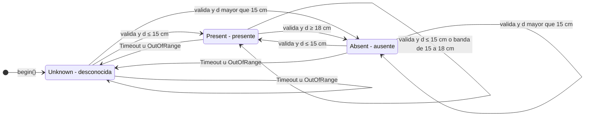

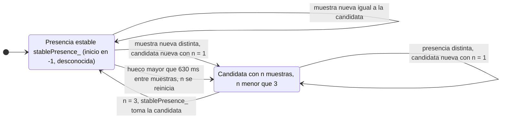

El primer diagrama es la regla de [`UltrasonicSensor::measure()`](../src/UltrasonicSensor.cpp#L23-L38), que se evalúa en cada lectura (cada 500 ms). Una lectura válida de 15 cm o menos marca `Present`, y para volver a `Absent` hace falta llegar a 18 cm (`VEHICLE_DETECTION_CM + DETECTION_HYSTERESIS_CM`). Dentro de la banda se conserva el estado anterior, salvo desde `Unknown`, que pasa a `Absent`. Cualquier `Timeout` u `OutOfRange` invalida la presencia: el código nunca reutiliza una detección vieja. El segundo diagrama es el filtro de [`step()`](../src/AwsIoTManager.cpp#L281-L291), que solo publica una presencia cuando 3 muestras consecutivas (`AWS_PRESENCE_STABLE_SAMPLES`) coinciden. Si entre dos muestras pasan más de 630 ms (`SENSOR_INTERVAL_MS + ECHO_TIMEOUT_US/1000 + 100`), por ejemplo durante un *handshake* TLS, el conteo se reinicia. Además, [`report()`](../src/AwsIoTManager.cpp#L254) publica `null` como presencia si la distancia actual no es válida.

**Máquina de estados de la barrera**

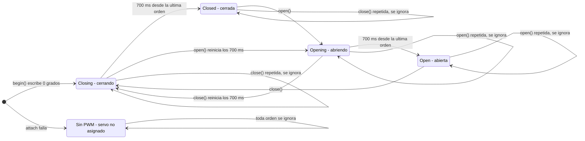

[`BarrierServo`](../src/BarrierServo.cpp) solo guarda el estado **ordenado** (`commanded_`) y una bandera `moving_`, así que *Opening* y *Closing* son la combinación de `commanded_` con `moving_ = true`. Una orden igual a la vigente devuelve `false` sin escribir el PWM ni reiniciar el temporizador. Una orden opuesta escribe el nuevo ángulo de inmediato y reinicia la cuenta de 700 ms (`SERVO_TRAVEL_MS`). `update()`, llamado en cada vuelta de `loop()`, apaga `moving_` cuando se cumple el tiempo, y solo entonces `positionEstimated()` es verdadero y la tarea de red puede confirmar el estado en `reported` (`Snapshot.ready`). Nada en este ciclo mide la posición real.

**Máquina de estados de la conexión con AWS**

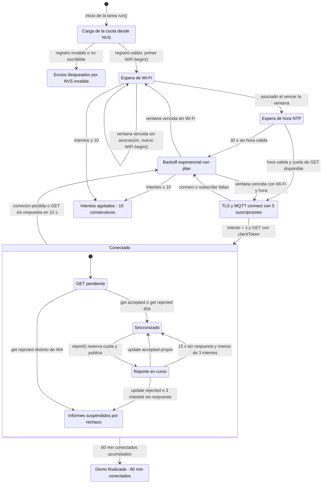

El diagrama sale de [`run()`](../src/AwsIoTManager.cpp#L75-L95), [`connectStep()`](../src/AwsIoTManager.cpp#L128-L170), [`failedAttempt()`](../src/AwsIoTManager.cpp#L117-L127), [`receive()`](../src/AwsIoTManager.cpp#L192-L243) y [`step()`](../src/AwsIoTManager.cpp#L265-L347). Cuentan como intento cada `WiFi.begin()`, cada `failedAttempt()` y también la conexión MQTT, y el contador vuelve a 0 cuando llega un GET válido (`get/accepted` o `get/rejected` con 404): el límite de 10 es de intentos consecutivos sin sincronizar, no por arranque. Las ventanas de espera se duplican desde 5 s hasta 300 s, con un *jitter* de 0 a 999 ms. Sin cuota para el GET de recuperación, `connectStep()` retorna sin consumir intentos y el dispositivo queda desconectado. En *Informes suspendidos* la conexión sigue abierta: el ESP32 todavía recibe y ejecuta los `delta`, pero no publica hasta reconectar. *Demo finalizada*, *Intentos agotados* y *Envíos bloqueados* solo se abandonan reiniciando la placa, y en los tres el sensor, el servo y la consola serie siguen activos.

**Diagrama de actividad de la decisión de reporte**

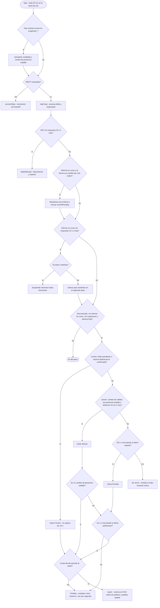

La prioridad es fija: **Control > Sensor > Periodic**. Una orden ejecutada se confirma sin esperar el intervalo mínimo, y si había otro informe pendiente de acuse con el estado anterior de la barrera, se abandona (su reserva no se devuelve y su `accepted` tardío se ignora por el `clientToken`). El reintento por falta de `accepted` no es un mecanismo aparte: al vencer los 15 s, el paso siguiente vuelve a comparar `current_` con `confirmed_`, que no cambió, y genera un informe nuevo con un token nuevo. Cada intento consume cuota, y tras el tercero se suspenden los informes. La cuota se verifica dos veces: aquí, con `allows()`, y en `report()`, con `reserve()`, que además la persiste. Un cambio de presencia estable es la excepción dentro de la clase `Sensor`: no pasa por la comprobación de los 10 s y, si hay un informe ordinario pendiente de acuse con la presencia anterior, lo abandona y publica de inmediato (su reserva tampoco se devuelve). Aun así, usa la cuota ordinaria y no puede gastar la reserva de 200.

#### 2.3.2 Función Lambda (backend de la skill)

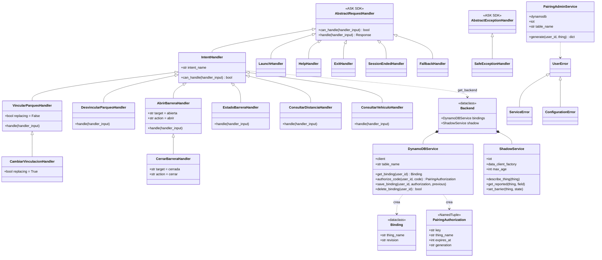

*`lambda_function.py` registra los 13 handlers en el `SkillBuilder` (Launch, Vincular, Cambiar, Desvincular, Distancia, Vehículo, Abrir, Cerrar, Estado, Help, Exit, SessionEnded y Fallback) y, antes de entregar el evento al SDK, valida el Skill ID, la antigüedad de la solicitud y el `userId`. Las funciones `validate_user`, `validate_thing` y `pairing_key` ([`services/validation.py`](../lambda/services/validation.py)) y `pairing_window_key` ([`services/pairing_policy.py`](../lambda/services/pairing_policy.py)) son módulos sin estado compartidos por ambas Lambdas. `PairingAdminService` vive solo en el ZIP administrativo ([`administration/`](../lambda/administration/)).*

**Notas de diseño.**

1. **Herencia mínima para no repetir código.** `IntentHandler` resuelve `can_handle` por nombre de intent. `Cerrar` hereda de `Abrir` cambiando solo `target` y `action`, y `Cambiar` hereda de `Vincular` cambiando solo `replacing`.
2. **Servicios inyectables.** `Backend` se construye una vez por contenedor (`lru_cache`) con clientes boto3 de **un solo intento**: sin reintentos ocultos, conexión de 0,5 s y lectura de 1 s. Las pruebas reemplazan esos clientes por dobles ([`lambda/tests/fakes.py`](../lambda/tests/fakes.py)).
3. **Errores aptos para voz.** `UserError` lleva mensajes constantes en español; `ServiceError` oculta los detalles de AWS. `SafeExceptionHandler` registra solo el tipo de excepción, nunca el `userId`, el PIN ni el Thing.
4. **Separación de privilegios.** La generación del PIN está en otra función, con otro rol y otro paquete. El ZIP de Alexa no contiene `admin_lambda_function.py` ni `administration/`, y [`scripts/verify_package.py`](../lambda/scripts/verify_package.py) lo comprueba.
5. **Extensibilidad.** Una consulta nueva es una subclase de `IntentHandler` de unas 8 líneas que llama a `get_reported(thing, "<campo>")`.

**Patrones de diseño presentes en la Lambda**

| Patrón | Dónde se ve en el código | Qué resuelve |
|---|---|---|
| Herencia con sobrescritura de atributos | `CerrarBarreraHandler(AbrirBarreraHandler)` cambia solo `intent_name`, `target` y `action` ([`barrier_handlers.py`](../lambda/handlers/barrier_handlers.py#L21-L24)); `CambiarVinculacionHandler` cambia solo `replacing` ([`binding_handlers.py`](../lambda/handlers/binding_handlers.py#L30-L32)) | Una sola implementación de `handle()` por familia de intents. |
| Cadena de responsabilidad | El `SkillBuilder` prueba `can_handle()` en el orden de registro; `FallbackHandler` va al final y acepta todo ([`lambda_function.py`](../lambda/lambda_function.py#L16-L21), [`system_handlers.py`](../lambda/handlers/system_handlers.py#L50-L52)) | Toda solicitud recibe respuesta, aunque no corresponda a ningún intent. |
| Inyección de dependencias | `DynamoDBService(client, table_name, clock)`, `ShadowService(iot_client, data_client_factory, max_age, clock)` y `PairingAdminService(dynamodb, iot, table_name, clock)` reciben sus clientes y su reloj por el constructor | Las pruebas sustituyen boto3 y el tiempo por dobles ([`tests/fakes.py`](../lambda/tests/fakes.py)). |
| Fábrica perezosa con caché | `get_backend()` y `data_client()` con `@lru_cache(maxsize=1)` ([`runtime.py`](../lambda/services/runtime.py#L28-L52)) | Los clientes se crean en la primera solicitud del contenedor y se reutilizan; importar el módulo no llama a AWS. |
| Traducción de excepciones | `BotoCoreError`/`ClientError` → `ServiceError` o `UserError` con mensaje constante ([`errors.py`](../lambda/services/errors.py)) | El usuario nunca oye un mensaje de AWS y los logs no reciben datos personales. |

**Diagrama de actividad de la validación de una solicitud**

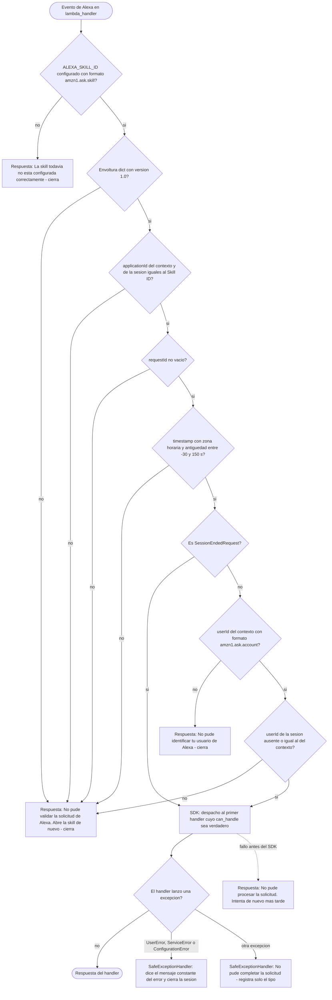

La validación ocurre en [`lambda_handler()`](../lambda/lambda_function.py#L30-L67) **antes** de crear cualquier cliente boto3, así que una solicitud de otra skill o un evento reproducido fuera de la ventana de −30 a 150 s no genera operaciones en DynamoDB ni en IoT. Las respuestas de error se construyen a mano con `shouldEndSession: true`. Dentro del SDK, `SafeExceptionHandler` registra en CloudWatch el **tipo** de toda excepción que no sea un `UserError` puro (incluidas `ServiceError` y `ConfigurationError`, que son subclases), nunca su contenido. El `except Exception` final cubre fallos de deserialización del SDK que ocurren antes de llegar al manejador de excepciones.

### 2.4 Diagramas de secuencia

#### 2.4.1 Vinculación de un Thing

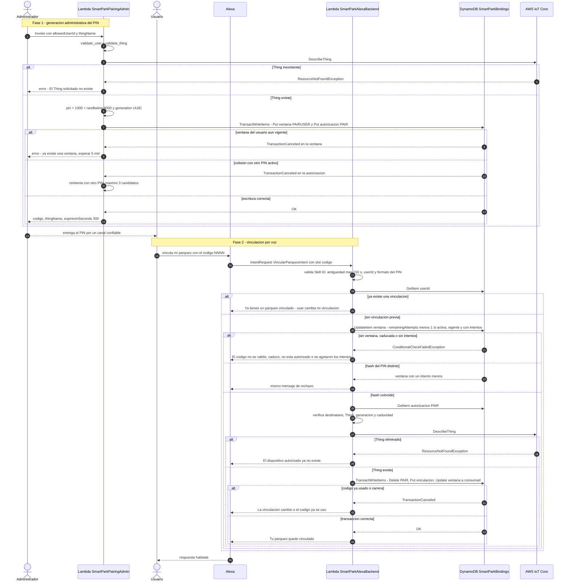

El intento se descuenta **antes** de comparar el hash y no se devuelve aunque la operación falle después. Con solicitudes simultáneas, solo 3 pueden reservar un intento; la prueba `test_parallel_guesses_never_exceed_three` lo cubre.

#### 2.4.2 Consulta del sensor

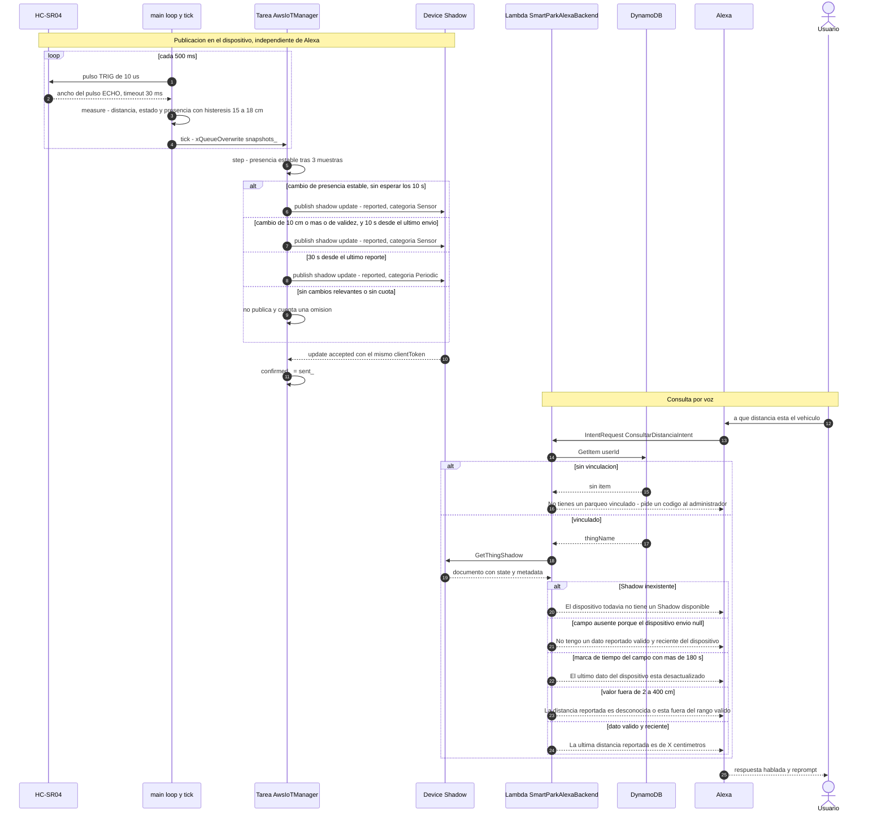

En la publicación, un cambio de presencia estable no espera los 10 s desde el último envío (2.3.1); esa espera solo se aplica a los cambios de distancia y de validez. La consulta de presencia (`ConsultarVehiculoIntent`) sigue el mismo camino con el campo `vehiculo_detectado`. La frescura se evalúa **por campo**, con `metadata.reported.<campo>.timestamp`, y no con la marca del documento completo.

#### 2.4.3 Comando sobre el actuador

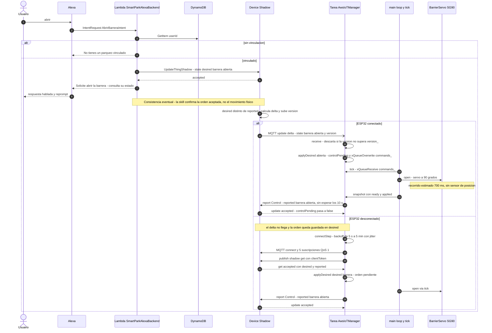

Si el usuario pregunta *"consultar estado"* antes de que llegue la confirmación, la Lambda responde con el último `reported`, que todavía puede ser *cerrada*. Por eso la respuesta a la orden es *"Solicité abrir la barrera"* y no *"La barrera está abierta"*. Si el ESP32 ya cumplió esa orden y la tiene confirmada, `applyDesired()` no mueve ni publica nada.

### 2.5 Especificación del documento Shadow

Se usa el **Shadow clásico** (sin nombre) del Thing `smartpark-grupo9-01`.

| Sección | Atributo | Tipo JSON | Valores válidos | Quién escribe | Significado |
|---|---|---|---|---|---|
| `reported` | `barrera` | string | `"abierta"`, `"cerrada"` | ESP32 | Última posición **ordenada y estimada** como alcanzada (700 ms después de la orden). |
| `reported` | `barrera_posicion_estimada` | boolean | `true` | ESP32 | Indica que `barrera` es una posición **estimada** por tiempo y no medida, porque el SG90 no tiene realimentación hacia el ESP32. El firmware siempre envía `true`. |
| `reported` | `distancia_cm` | number o `null` | 2,0 a 400,0, con 1 decimal | ESP32 | Última distancia válida. `null` si la lectura fue timeout o estuvo fuera de rango. |
| `reported` | `vehiculo_detectado` | boolean o `null` | `true`, `false` | ESP32 | Presencia estable (3 muestras): `true` si ≤ 15 cm y `false` si ≥ 18 cm. `null` si es desconocida o la distancia no es válida. |
| `desired` | `barrera` | string o `null` | `"abierta"`, `"cerrada"` | Lambda (o la consola en pruebas) | Orden pendiente o vigente. `null` retira la orden (uso de prueba). |
| `delta` | `barrera` | string | `"abierta"`, `"cerrada"` | AWS IoT (calculado) | Existe solo cuando `desired.barrera` difiere de `reported.barrera`. |

**Ejemplo del documento** (valores ilustrativos):

```json
{
  "state": {
    "desired":  { "barrera": "abierta" },
    "reported": { "barrera_posicion_estimada": true, "barrera": "cerrada", "distancia_cm": 12.4, "vehiculo_detectado": true }
  },
  "metadata": {
    "desired":  { "barrera": { "timestamp": 1794056400 } },
    "reported": {
      "barrera_posicion_estimada": { "timestamp": 1794056340 },
      "barrera": { "timestamp": 1794056340 },
      "distancia_cm": { "timestamp": 1794056340 },
      "vehiculo_detectado": { "timestamp": 1794056340 }
    }
  },
  "version": 42
}
```

**Mensaje `delta`** que recibe el ESP32 en `…/shadow/update/delta`:

```json
{ "version": 43, "timestamp": 1794056400, "state": { "barrera": "abierta" }, "metadata": { "barrera": { "timestamp": 1794056400 } } }
```

**Reporte que publica el ESP32** en `…/shadow/update` ([`report()`](../src/AwsIoTManager.cpp#L244)), en este caso tras una lectura inválida:

```json
{ "clientToken": "1a2b3c4d-7", "state": { "reported": { "barrera_posicion_estimada": true, "barrera": "abierta", "distancia_cm": null, "vehiculo_detectado": null } } }
```

**Uso de `null`.** En el Shadow, `null` **elimina** el atributo. El firmware lo usa a propósito: una lectura inválida borra la distancia vieja en vez de dejar un valor engañoso o publicar un 0 falso. En la Lambda, un atributo ausente produce *"No tengo un dato reportado válido y reciente del dispositivo."*

**Temas MQTT suscritos.** Son exactamente 5, con QoS 1 y sin comodines ([`connectStep()`](../src/AwsIoTManager.cpp#L159)):

| # | Tema | Uso |
|---|---|---|
| 1 | `$aws/things/smartpark-grupo9-01/shadow/update/delta` | Recibir órdenes (`desired` ≠ `reported`). |
| 2 | `$aws/things/smartpark-grupo9-01/shadow/get/accepted` | Recibir el documento completo tras el GET de sincronización. |
| 3 | `$aws/things/smartpark-grupo9-01/shadow/get/rejected` | GET rechazado. Un 404 significa que el Shadow todavía no existe y se crea con el primer reporte. |
| 4 | `$aws/things/smartpark-grupo9-01/shadow/update/accepted` | Confirmación de cada reporte propio. |
| 5 | `$aws/things/smartpark-grupo9-01/shadow/update/rejected` | Rechazo de un reporte: se suspenden los informes hasta reconectar. |

Solo se publica en `…/shadow/get` y `…/shadow/update`. No hay suscripción a `update/documents`, así que el dispositivo no recibe el documento completo en cada cambio.

**`clientToken` y `version`.**

- Cada GET o UPDATE propio lleva un `clientToken` aleatorio con número de secuencia (`%08lx-%lu`). Una respuesta `accepted` o `rejected` solo se considera propia si trae el mismo token. Así no se confunde el `accepted` de una orden dada desde la consola con la confirmación del ESP32.
- `version_` guarda la última versión procesada. Un `delta` con versión menor o igual se descarta, y un GET más viejo que un `delta` ya procesado no pisa el estado.

**Regla de frescura en la Lambda.** [`ShadowService.get_reported`](../lambda/services/shadow_service.py#L44) rechaza un campo cuya marca de tiempo tenga más de `MAX_REPORTED_AGE_SECONDS` (180 s por defecto) o esté más de 30 s en el futuro. Con un respaldo periódico de 30 s, un dispositivo conectado y con cuota no llega a los 180 s: harían falta 5 respaldos perdidos seguidos para alcanzar ese límite. Si los supera, es porque se desconectó o agotó su cuota ordinaria, y la skill lo dice en lugar de responder con un dato viejo.

**Ciclo de vida de cada atributo**

| Atributo | Quién lo crea | Cuándo cambia | Cuándo se borra |
|---|---|---|---|
| `reported.barrera` | El ESP32, en el primer `report()` tras sincronizar (si el Shadow no existía, el GET devuelve 404 y el primer UPDATE lo crea) | En cada reporte; su valor cambia solo cuando termina el recorrido estimado de una orden | Nunca: el firmware siempre publica `"abierta"` o `"cerrada"` |
| `reported.barrera_posicion_estimada` | El ESP32, en el primer `report()` tras sincronizar | Nunca: siempre vale `true` | Nunca: el firmware lo incluye en cada reporte |
| `reported.distancia_cm` | El ESP32, con la primera lectura válida | En cada reporte, redondeada a 1 decimal (`roundf(d·10)/10`) | Cuando se reporta con la lectura actual en `Timeout` u `OutOfRange` (se envía `null`) |
| `reported.vehiculo_detectado` | El ESP32, cuando hay una presencia estable y la lectura actual es válida | Cuando cambia la presencia estable (3 muestras) | Cuando la presencia estable es desconocida o la lectura actual no es válida (`null`) |
| `desired.barrera` | La Lambda, con la primera orden de voz (o la consola, en pruebas) | Con cada orden de voz | Ningún componente lo borra. Solo se retira a mano desde la consola, con `{"state":{"desired":{"barrera":null}}}`, en las pruebas puramente serie |

**`version` y `metadata`.** AWS IoT aumenta `version` en cada actualización aceptada del documento. El firmware la usa para descartar `delta` atrasados (`version <= version_`) y para que un GET más viejo que un `delta` ya procesado no pise el estado (`version < version_`). `version_` vuelve a 0 en cada conexión nueva ([`connectStep()`](../src/AwsIoTManager.cpp#L167)), porque el GET posterior trae el estado completo. `metadata` guarda una marca de tiempo **por atributo**, y es lo que la Lambda usa para la frescura. Que el documento tenga una marca reciente no rejuvenece un atributo que no se actualizó (prueba `test_stale_per_field_even_when_document_is_new`). El firmware no lee `metadata`.

**Secuencia de documentos durante una orden** (valores **ilustrativos**: las versiones y las marcas de tiempo son inventadas para el ejemplo; los nombres y la estructura son los reales):

| Momento | `desired` | `reported` | `delta` publicado | `version` |
|---|---|---|---|---|
| t₀ — reposo | `{"barrera": "cerrada"}` | `{"barrera_posicion_estimada": true, "barrera": "cerrada", "distancia_cm": 12.4, "vehiculo_detectado": true}` | — | 41 |
| t₁ — la Lambda escribe la orden | `{"barrera": "abierta"}` | Sin cambios | `{"state": {"barrera": "abierta"}, "version": 42}` | 42 |
| t₁ + 0,7 s — el ESP32 confirma | `{"barrera": "abierta"}` | `{"barrera_posicion_estimada": true, "barrera": "abierta", "distancia_cm": 12.4, "vehiculo_detectado": true}` | — (`desired` y `reported` coinciden) | 43 |
| t₂ — el vehículo pasa y la lectura falla | `{"barrera": "abierta"}` | `{"barrera_posicion_estimada": true, "barrera": "abierta"}`: `distancia_cm` y `vehiculo_detectado` se borraron con `null` | — | 44 |

### 2.6 Política de reporte

| Parámetro (`config.h`) | Valor | Justificación por la dinámica de la variable |
|---|---|---|
| `SENSOR_INTERVAL_MS` | 500 ms | Una muestra cada medio segundo capta el acercamiento de un vehículo de maqueta. El sensor bloquea como máximo 30 ms por lectura. |
| `AWS_PRESENCE_STABLE_SAMPLES` | 3 | La presencia solo cambia si 3 muestras consecutivas coinciden (≈ 1,5 s). Filtra ecos espurios sin perder un vehículo que se detiene. |
| `VEHICLE_DETECTION_CM` / `DETECTION_HYSTERESIS_CM` | 15 cm / 3 cm | Presente si ≤ 15 cm y ausente si ≥ 18 cm. La banda de 3 cm evita oscilaciones con el objeto cerca del umbral. |
| `AWS_DISTANCE_CHANGE_THRESHOLD_CM` | 10 cm | Una variación menor que 10 cm no cambia la decisión de abrir y no genera envíos. La llegada y la salida del vehículo se publican por presencia, sin depender de este umbral. |
| `AWS_MIN_PUBLISH_INTERVAL_MS` | 10 s | Separación mínima entre reportes ordinarios por distancia, validez o respaldo. Ni las confirmaciones de control ni los cambios de presencia estable esperan este intervalo. |
| `AWS_REPORT_INTERVAL_MS` | 30 s | Respaldo periódico. Refresca las marcas de tiempo para que la Lambda siga aceptando el dato: el umbral de 180 s equivale a 180 / 30 = 6 respaldos. |
| `AWS_MAX_SHADOW_UPDATES_PER_DAY` | 1000 | Techo diario de GET + UPDATE intentados, persistido en NVS. |
| `AWS_RESERVED_CONTROL_UPDATES` | 200 | A partir de 1000 − 200 = 800 solicitudes, `allows()` solo deja pasar `Control` y `Recovery` (GET de recuperación). |
| `AWS_DEMO_MAX_CONNECTED_MS` | 3 600 000 ms (60 min) | Límite de tiempo conectado por arranque. |
| `SERVO_TRAVEL_MS` | 700 ms | Espera antes de confirmar un cambio de barrera. |

**Estimación de solicitudes para una demo de 60 min.** Se calcula solo con los valores anteriores; es una **estimación de diseño, no una medición de AWS**:

| Escenario | Cálculo | Solicitudes del dispositivo |
|---|---|---|
| Reposo (sin cambios) | 1 GET inicial + 0 o 1 sincronización de barrera (Control, ver c₀ más abajo) + 3 600 s / 30 s ≈ 119–120 respaldos | **≈ 120–122** |
| Con 10 órdenes de voz | Reposo + 10 confirmaciones de control | ≈ 130–132 |
| Peor caso por distancia (cambios constantes de ≥ 10 cm) | 3 600 s / 10 s = 360 reportes `Sensor`; cada uno reinicia el respaldo de 30 s, así que no quedan periódicos | **≤ 361** + las de control; no alcanza las 800 ordinarias |
| Peor caso por presencia (el objeto cruza 15 y 18 cm cada 1,5 s) | 3 600 s / 1,5 s = 2 400 posibles, pero se cortan en el techo de 800 ordinarias | **≤ 800** + hasta 200 de control y GET = **≤ 1000** |
| Referencia: conectado todo el día sin límite de demo | 24 h × 120 respaldos por hora = 2 880, por encima de las 800 ordinarias | Los respaldos se cortarían tras ≈ 800 × 30 s ≈ 6,7 h. Por eso existen el límite de 60 min y la cuota. |

Además, cada UPDATE aceptado genera del lado de AWS un mensaje `update/accepted` hacia el ESP32 y, si hay diferencia, un `delta`. La Lambda suma una llamada `GetThingShadow` por consulta y una `UpdateThingShadow` por orden. Estas operaciones **no** entran en el contador local del firmware.

**Cálculo detallado de la estimación.** Las variables salen de [`config.example.h`](../include/config.example.h):

- T_demo = 3 600 s (`AWS_DEMO_MAX_CONNECTED_MS`)
- T_per = 30 s (`AWS_REPORT_INTERVAL_MS`)
- T_min = 10 s (`AWS_MIN_PUBLISH_INTERVAL_MS`)
- T_pres = 3 × 500 ms = 1,5 s (`AWS_PRESENCE_STABLE_SAMPLES` × `SENSOR_INTERVAL_MS`): separación mínima entre dos cambios de presencia estable
- L = 1000 (`AWS_MAX_SHADOW_UPDATES_PER_DAY`)
- R = 200 (`AWS_RESERVED_CONTROL_UPDATES`)
- N_ord = órdenes de voz; N_rec = reconexiones; E_D = cambios relevantes de distancia o de validez; E_P = cambios de presencia estable

*Lo que cuenta el firmware* (cada solicitud se reserva en NVS antes de enviarse):

| Categoría | Fórmula | Comentario |
|---|---|---|
| `Recovery` (GET) | N_GET = 1 + N_rec | Un GET por conexión, nunca por lectura. Puede usar la reserva: se permite mientras N_total < L. |
| `Control` | N_C = N_ord + c₀ | c₀ = 1 si, tras el GET, el Shadow no tenía `reported.barrera` o difería de la posición tras el arranque (siempre cerrada). Si no, c₀ = 0. |
| `Sensor` | N_S = min(E_D, ⌊T_demo / T_min⌋) + min(E_P, ⌊T_demo / T_pres⌋) = min(E_D, 360) + min(E_P, 2 400) | Los cambios de distancia o validez exigen ≥ 10 s desde la publicación anterior. Los de presencia no esperan, pero cada uno necesita 3 muestras nuevas. |
| `Periodic` | N_P ≤ ⌈T_demo / T_per⌉ = 120 | Cualquier reporte reinicia el contador de 30 s (`lastReport_`), así que la actividad **reduce** los periódicos. |
| Restricciones | `Periodic` y `Sensor` solo salen si N_total < L − R = 800; `Control` y `Recovery`, si N_total < L = 1000 | Por día UTC, no por sesión (`allows()`). |

| Escenario (60 min) | Supuestos | N_GET | N_C | N_S | N_P | Total |
|---|---|---|---|---|---|---|
| Reposo | N_ord = 0, E_D = E_P = 0, sin reconexiones | 1 | 0–1 | 0 | 119–120 | **120–122** |
| Actividad moderada (ilustrativa) | 10 vehículos con 2 reportes `Sensor` cada uno (llegada y salida) y 2 órdenes por vehículo (abrir y cerrar) | 1 | 20–21 | 20 | ≤ 120 | **≤ 162** |
| Peor caso por distancia | Cambios continuos de ≥ 10 cm sin cambio de presencia | 1 | N_ord + c₀ | 360 | 0 | **≤ 361 + N_C** (las 800 ordinarias no se alcanzan en 60 min: 800 × 10 s ≈ 2,2 h) |
| Peor caso por presencia | La presencia estable cambia cada 1,5 s | 1 | hasta 200 | hasta 799 | — | **≤ 1000** (las ordinarias se agotan tras ≈ 800 × 1,5 s = 1 200 s = 20 min) |

*Lo que genera AWS y no cuenta el firmware:*

| Origen | Por evento | Fórmula en 60 min |
|---|---|---|
| Respuesta a cada UPDATE del ESP32 | 1 mensaje `update/accepted` (o `rejected`) hacia el dispositivo | N_S + N_P + N_C |
| Respuesta a cada GET | 1 mensaje `get/accepted` (o `rejected`) | N_GET |
| Cada orden de voz | 1 `UpdateThingShadow` HTTPS de la Lambda, 1 `delta` hacia el ESP32 y 1 `update/accepted` de esa escritura, que el ESP32 recibe porque está suscrito y descarta por el `clientToken` | N_ord · (1 llamada + 2 mensajes) |
| Cada consulta de voz | 1 `GetItem` y 1 `GetThingShadow` | N_q · 2 llamadas |
| Cada orden de voz (lado DynamoDB) | 1 `GetItem` de la vinculación | N_ord |
| Primera solicitud de cada contenedor Lambda | 1 `DescribeEndpoint` si no se configuró `IOT_DATA_ENDPOINT` | ≤ número de contenedores |

En reposo, el ESP32 recibe ≈ N_total mensajes de respuesta, además del PING de MQTT cada 120 s (*keepalive*), que no es una operación del Shadow. **No se incluyen precios**: la tarifa depende de la región, del plan de la cuenta y de su capa gratuita, y debe consultarse en la [página oficial de precios de AWS IoT Core](https://aws.amazon.com/iot-core/pricing/) en la fecha en que se haga la estimación.

**Relación con la capa gratuita.** Las 1000 por día son un **límite local académico**, como indica el comentario de `config.example.h`, y no la cuota oficial de AWS. Como cota local, un dispositivo no puede intentar más de 1000 × 31 = 31 000 solicitudes Shadow en un mes de 31 días. Una demo de 60 min en reposo usa ≈ 120–122 (≈ 12 % del techo diario), así que caben unas 6 demos completas en reposo por día UTC antes de llegar a las 800 ordinarias (6 × 122 = 732). Estas cifras mantienen el uso diario bajo y predecible, pero son estimaciones de diseño. El costo real depende de la cuenta (elegibilidad, créditos y fecha de alta) y debe revisarse en la [tarifa oficial de IoT Core](https://aws.amazon.com/iot-core/pricing/) y en Billing.

> ⏳ **PENDIENTE (manual):** verificar en AWS Billing → *Free Tier* el uso real de AWS IoT, Lambda y DynamoDB después de la demo y guardar la captura en `docs/evidencias/aws-iot/billing-free-tier.png`.

**Compromiso entre latencia de eventos y cuota.** Para eventos discretos, reportar en el orden de 1 s minimizaría la latencia. El diseño separa los dos casos: la presencia, que es el evento discreto que el usuario consulta, se publica apenas se estabiliza, y los cambios de distancia y de validez esperan **10 s de separación mínima**. La decisión es deliberada:

- Con 1 s también para la distancia, un objeto en movimiento podría generar hasta 3 600 solicitudes en 60 min y agotaría las 800 ordinarias en ≈ 800 s (≈ 13 min). Con 10 s, el máximo por distancia es de 360 en 60 min.
- El evento crítico del caso de uso, el cambio de la barrera, **no espera** esos 10 s: se confirma apenas termina el recorrido estimado de 700 ms.
- La presencia necesita 3 muestras iguales (3 × 500 ms): queda estable entre 1,0 y 1,5 s después del cambio físico, según en qué momento del ciclo de 500 ms ocurra, y se publica en ese momento aunque el último reporte haya sido hace menos de 10 s. Si había un reporte ordinario pendiente de acuse con la presencia anterior, lo desplaza. Esas 3 muestras son también lo que limita su frecuencia: como máximo un cambio cada 1,5 s.

Con más cuota disponible, bastaría con bajar `AWS_MIN_PUBLISH_INTERVAL_MS` para que los cambios de distancia también se publiquen antes (7.6).

### 2.7 Diseño del mecanismo de vinculación

**Identificador elegido.** Un **PIN temporal de 4 dígitos** (1000–9999), generado con `secrets.randbelow` por una Lambda administrativa. Queda ligado a un `userId` y a un Thing concretos, vale 300 s y admite 3 intentos. No se usa el nombre del Thing ni un número de serie porque son adivinables o públicos.

**Flujo de generación.**

1. El administrador obtiene el `userId` de Alexa del usuario (del *JSON Input* del simulador) y verifica por un canal confiable que esté autorizado para el Thing.
2. Invoca `SmartParkPairingAdmin` con `{"allowedUserId": "amzn1.ask.account.…", "thingName": "smartpark-grupo9-01"}`. Si el evento trae cualquier otro campo, se rechaza.
3. La Lambda llama una vez a `DescribeThing`, genera el PIN y un `generation` UUID, y escribe dos registros en una transacción condicional.
4. Devuelve `{"codigo", "thingName", "expiresInSeconds": 300}` solo al operador, sin registrarlo en los logs.

**Modelo de datos.** Una sola tabla, `SmartParkBindings`, con clave de partición `userId` (String) y tres tipos de registro que se distinguen por el prefijo de la clave y por `recordType`:

| Tipo | Clave `userId` | Atributos | Ciclo de vida |
|---|---|---|---|
| Vinculación | `amzn1.ask.account.…` | `thingName`, `recordType = binding`, `revision` (UUID), `fechaVinculacion` (ISO 8601 UTC) | Persiste hasta desvincular o cambiar. |
| Autorización de PIN | `PAIR#<sha256(PIN)>` | `recordType = pairing`, `thingName`, `allowedUserId`, `expiresAt`, `generation` | Se borra al vincular. Si caduca, queda inerte y puede reemplazarse. |
| Ventana de intentos | `PAIRUSER#<sha256(userId)>` | `recordType = pairing_window`, `thingName`, `pairKey`, `generation`, `expiresAt`, `remainingAttempts`, `status` (`active` o `consumed`) | Permanece hasta caducar, aunque ya se haya consumido, para no reponer intentos antes de tiempo. |

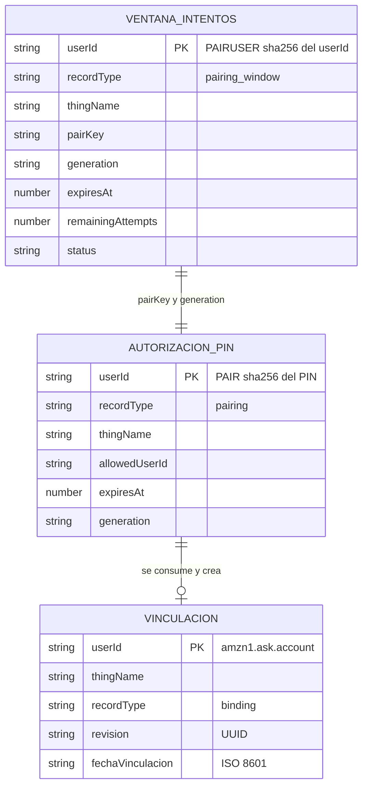

El PIN nunca se guarda en claro, solo su SHA-256. Como hay apenas 9 000 valores posibles, el hash no agrega entropía: la protección real viene de combinar destinatario obligatorio, 300 s, 3 intentos persistentes y generación administrativa separada.

**Validaciones** (en orden de ejecución):

1. Skill ID igual a `ALEXA_SKILL_ID` y solicitud con una antigüedad entre −30 y 150 s ([`lambda_function.py`](../lambda/lambda_function.py#L30)).
2. `userId` con formato `amzn1.ask.account.…` e igual en la sesión y en el contexto.
3. PIN de exactamente 4 dígitos ASCII que no empiece por 0, validado **antes** de cualquier llamada a AWS ([`pairing_key`](../lambda/services/validation.py#L22)).
4. Sin vinculación previa para `Vincular`, o con vinculación previa para `Cambiar`.
5. Reserva atómica de un intento: `UpdateItem` condicionado a `status = active`, `expiresAt > now` y `remainingAttempts > 0`.
6. Comparación en tiempo constante (`hmac.compare_digest`) entre el hash del PIN y el `pairKey` de la ventana del usuario.
7. Lectura de `PAIR#…` y verificación de `allowedUserId`, `thingName`, `generation` y `expiresAt`.
8. `DescribeThing`, para confirmar que el Thing todavía existe.
9. Transacción condicional final.

**Transacción de 3 acciones** ([`save_binding`](../lambda/services/dynamodb_service.py#L107)):

1. `Delete` de `PAIR#…`, con todas sus condiciones.
2. `Put` de la vinculación, con la condición de que no exista o de que conserve la `revision` leída.
3. `Update` de la ventana a `consumed`, con `remainingAttempts = 0`.

O se aplican las tres o no se aplica ninguna. Así un PIN no puede vincular dos veces y un cambio concurrente no pisa una vinculación más nueva.

**Cambio y desvinculación.** `CambiarVinculacionIntent` exige un PIN nuevo y reemplaza el Thing con la misma transacción, condicionada a la `revision` anterior. Si el Thing es el mismo, el PIN se consume igual. `DesvincularParqueoIntent` hace un `DeleteItem` condicional sobre la fila del usuario y no reabre la ventana de intentos.

**Análisis de seguridad.** Con una ventana y 3 intentos, la probabilidad de acertar adivinando al azar es como máximo **3 / 9 000 ≈ 0,033 % por ventana**, y el administrador no puede abrir una segunda ventana para el mismo usuario hasta que caduque la primera. Limitaciones:

- Quien comparte la cuenta Alexa comparte el `userId`.
- Un atacante puede gastar los 3 intentos y bloquear la vinculación durante 5 min (denegación de servicio).
- El PIN corto sirve para una demo supervisada, no para producción (7.4).

**Máquina de estados de la ventana de vinculación** (registro `PAIRUSER#<sha256(userId)>`)

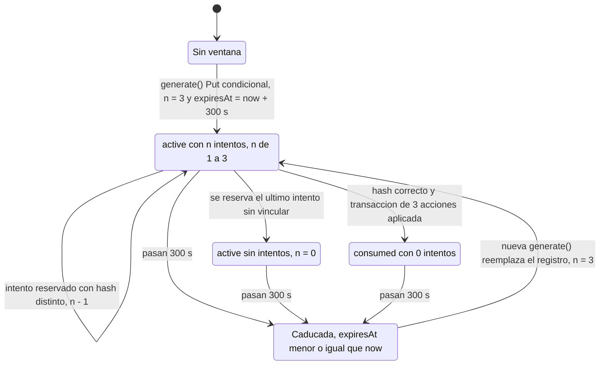

**Máquina de estados de la autorización** (registro `PAIR#<sha256(PIN)>`)

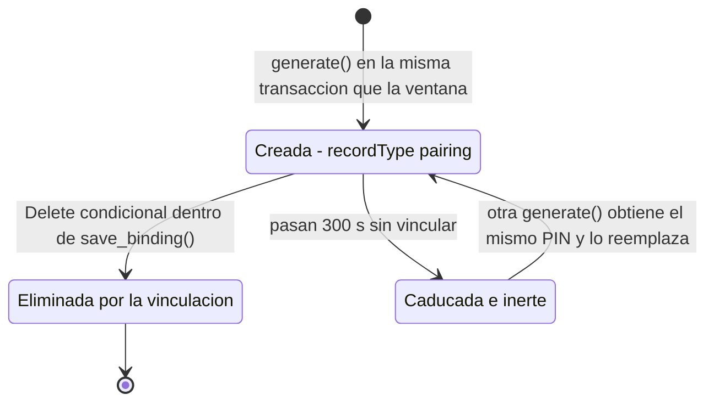

Los dos registros nacen juntos en una transacción de dos `Put` ([`pairing_service.py`](../lambda/administration/pairing_service.py#L49-L58)), cada uno con la condición `attribute_not_exists(userId) OR (recordType = :type AND expiresAt <= :now)`. Por eso una ventana vigente, aunque esté consumida o sin intentos, impide generar otra para el mismo usuario hasta que pasen los 300 s. Cada intento con formato válido se **reserva antes** de comparar el hash ([`authorize_code()`](../lambda/services/dynamodb_service.py#L60-L105)), incluido el correcto, y no se devuelve si la transacción final falla. En la ventana *active* con n = 0, la reserva condicional `remainingAttempts > :zero` falla y la solicitud se rechaza sin leer `PAIR#`. Ningún registro se borra al caducar: queda inerte, porque todas las condiciones comparan `expiresAt` con la hora actual, y una generación posterior lo reemplaza.

**Análisis de amenazas (STRIDE)**

| Categoría | Amenaza concreta | Mitigación existente en el código o la configuración | Riesgo residual |
|---|---|---|---|
| Suplantación (*Spoofing*) | Otro cliente MQTT se hace pasar por el ESP32 | TLS mutuo con X.509 y política `iot:Connect` limitada al client ID `smartpark-grupo9-01` | Si se filtra `secrets.h` o el binario (que contiene las credenciales), el certificado debe revocarse en AWS. |
| Suplantación | Una skill ajena o una solicitud fabricada invoca la Lambda | Disparador restringido al Skill ID y comparación de `applicationId` en [`lambda_handler()`](../lambda/lambda_function.py#L33-L45) | Depende de configurar bien el disparador (⏳ PENDIENTE de captura, 3.3). |
| Suplantación | Otra persona usa la cuenta de Alexa del usuario | — | Sin mitigar: quien comparte la cuenta comparte el `userId` y no hay reconocimiento de voz. |
| Manipulación (*Tampering*) | Alguien adivina el PIN de otro usuario | El PIN solo vale para el `allowedUserId`; 3 intentos atómicos, 300 s y un solo uso | 3 / 9 000 ≈ 0,033 % por ventana. |
| Manipulación | Una orden vieja o reordenada mueve la barrera | `version` descarta `delta` atrasados; `applyDesired()` acepta solo `"abierta"` y `"cerrada"` | Una orden legítima pero tardía se aplica igual; es el comportamiento esperado del Shadow. |
| Manipulación | Dos cambios de vinculación simultáneos | `revision` UUID y condiciones de la transacción ([`save_binding()`](../lambda/services/dynamodb_service.py#L107-L160)) | Ninguno conocido; cubierto por `test_binding_race_does_not_replace_newer_binding`. |
| Repudio (*Repudiation*) | Un usuario niega haber abierto la barrera | Ninguna: los logs no registran el `userId` ni las órdenes, por diseño (privacidad) | No hay historial de accesos (ver 7.10). |
| Divulgación (*Information disclosure*) | Credenciales en el repositorio o en los logs | `secrets.h` y `config.h` en `.gitignore`; PIN guardado solo como hash; logs con solo el tipo de error | Los hashes de un PIN de 4 dígitos se invierten por fuerza bruta: la tabla debe tratarse como dato administrativo. El endpoint IoT está en `config.example.h` (7.5). |
| Denegación de servicio (*Denial of service*) | Un atacante gasta los 3 intentos o genera solicitudes inválidas | Ventana por usuario; formatos imposibles rechazados sin llamar a AWS; cuota del firmware | Puede bloquear la vinculación de ese usuario durante 5 min; las invocaciones rechazadas también tienen costo. |
| Denegación de servicio | Tormenta de reconexiones o de reportes del dispositivo | Backoff de 5 s a 5 min, 10 intentos consecutivos sin un GET válido, límite de demo de 60 min y 1000 solicitudes por día | Tras agotar los intentos, el dispositivo queda solo en modo local hasta reiniciarlo. |
| Elevación de privilegios (*Elevation of privilege*) | Usar la skill pública para generar PIN o leer el Thing de otro | La generación está en otra Lambda, con otro rol y otro paquete; el Thing sale de DynamoDB y nunca de un slot (`test_control_ignores_arbitrary_thing_slot`) | Mientras el rol de la Lambda tenga políticas *FullAccess*, un fallo del código tendría permisos de más (3.2.6). |

**Comparación con otras alternativas.**

| Alternativa | Ventaja | Desventaja | Decisión |
|---|---|---|---|
| Nombre del Thing | Simple | Trivial de adivinar y visible en el repositorio y en la consola | Descartada |
| Número de serie o MAC | Ligado al hardware | Impreso en la placa y adivinable por rango, sin caducidad ni límite de intentos | Descartada |
| Código publicado por el dispositivo en el Shadow | Prueba que se tiene el dispositivo | Más lógica en el firmware y más mensajes; quien lea el Shadow ve el código | Descartada en este prototipo |
| **PIN temporal administrativo** | Ligado a usuario y Thing; 300 s, 3 intentos, un solo uso; sin cambios en el firmware | Espacio pequeño (9 000); requiere un administrador | **Elegida** |
| Account Linking (OAuth) | Autenticación fuerte | Requiere un proveedor de identidad y un servicio de cuentas propio; fuera del alcance de este prototipo | Recomendación (7.4) |

### 2.8 Diseño de la skill de Alexa

| Elemento | Valor |
|---|---|
| Tipo | Skill custom con backend en AWS Lambda |
| Nombre de invocación | `parqueo inteligente` (aparece en [`system_handlers.py`](../lambda/handlers/system_handlers.py#L17) y en [`lambda/README.md`](../lambda/README.md)) |
| Locale | Español. Los eventos de prueba usan `es-ES`. |
| Slot | `codigo`, de tipo `AMAZON.FOUR_DIGIT_NUMBER`, en `VincularParqueoIntent` y `CambiarVinculacionIntent` |

> ⏳ **PENDIENTE (manual):** confirmar en Alexa Developer Console → *Invocations* que el nombre de invocación es exactamente `parqueo inteligente`, y anotar qué locale se usó (es-ES, es-US o es-MX). Si difiere, corregir esta tabla.

**Intents y frases de ejemplo** (fuente: [`lambda/README.md`](../lambda/README.md)):

| Intent | Frases de ejemplo | Slot | Handler |
|---|---|---|---|
| `VincularParqueoIntent` | "vincula mi parqueo con el código {codigo}" | `codigo` | `VincularParqueoHandler` |
| `CambiarVinculacionIntent` | "cambia mi vinculación con el código {codigo}" | `codigo` | `CambiarVinculacionHandler` |
| `DesvincularParqueoIntent` | "desvincula mi parqueo" | — | `DesvincularParqueoHandler` |
| `AbrirBarreraIntent` | "abrir" · "abre la barrera" | — | `AbrirBarreraHandler` |
| `CerrarBarreraIntent` | "cerrar" · "cierra la barrera" | — | `CerrarBarreraHandler` |
| `EstadoBarreraIntent` | "consultar estado" · "consulta el estado de la barrera" | — | `EstadoBarreraHandler` |
| `ConsultarDistanciaIntent` | "consultar distancia" · "a qué distancia está el vehículo" | — | `ConsultarDistanciaHandler` |
| `ConsultarVehiculoIntent` | "consultar vehículo" · "hay un vehículo esperando" | — | `ConsultarVehiculoHandler` |

**Intents y solicitudes del sistema.**

| Intent / solicitud | Comportamiento | `shouldEndSession` |
|---|---|---|
| `LaunchRequest` | Bienvenida. Si el usuario no está vinculado, explica cómo vincularse. | `false` + reprompt |
| `AMAZON.HelpIntent` | Enumera los comandos disponibles. | `false` + reprompt |
| `AMAZON.StopIntent` / `AMAZON.CancelIntent` | "Hasta luego." | `true` |
| `AMAZON.FallbackIntent` y cualquier solicitud no reconocida | Ofrece los comandos válidos. | `false` + reprompt |
| `SessionEndedRequest` | Respuesta vacía, sin voz. | — |

**Comportamiento de la sesión.** La sesión queda abierta (`shouldEndSession: false`, con *reprompt*) tras las respuestas correctas de abrir, cerrar, estado, distancia y vehículo, y también tras Launch, Help y Fallback. Cualquier otra respuesta la cierra, incluidos todos los errores, para no invitar a repetir una orden física cuya ejecución es incierta. Tras una orden, el reprompt es *"Puedes decir consultar estado, consultar distancia o salir."*; en los demás casos, *"Puedes decir abrir, cerrar, consultar estado, consultar distancia, consultar vehículo o salir."*

**Diálogo completo de ejemplo** (usuario ya vinculado; textos tomados de los handlers):

```text
Usuario: Alexa, abre parqueo inteligente.
Alexa:   Bienvenido a parqueo inteligente. Puedes decir abrir, consultar estado, cerrar o salir.
Usuario: hay un vehículo esperando
Alexa:   El último reporte indica que hay un vehículo esperando.
Usuario: abrir
Alexa:   Solicité abrir la barrera. Puedes consultar su estado para conocer el último reporte del dispositivo.
Usuario: consultar estado
Alexa:   Según el último estado reportado, la barrera está abierta.
Usuario: salir
Alexa:   Hasta luego.
```

**Tabla completa de mensajes de voz.** Los textos son exactos y vienen de [`handlers/`](../lambda/handlers/), [`services/`](../lambda/services/) y [`lambda_function.py`](../lambda/lambda_function.py). R1 = *"Puedes decir abrir, cerrar, consultar estado, consultar distancia, consultar vehículo o salir."* (`SESSION_REPROMPT`) y R2 = *"Puedes decir consultar estado, consultar distancia o salir."*

*Respuestas correctas:*

| Situación | Texto exacto | Sesión | *Reprompt* |
|---|---|---|---|
| `LaunchRequest`, usuario vinculado | "Bienvenido a parqueo inteligente. Puedes decir abrir, consultar estado, cerrar o salir." | Abierta | R1 |
| `LaunchRequest`, sin vinculación | "Bienvenido a parqueo inteligente. Primero pide un código al administrador y di: vincula mi parqueo con el código, seguido de los cuatro dígitos." | Abierta | R1 |
| `AbrirBarreraIntent` | "Solicité abrir la barrera. Puedes consultar su estado para conocer el último reporte del dispositivo." | Abierta | R2 |
| `CerrarBarreraIntent` | "Solicité cerrar la barrera. Puedes consultar su estado para conocer el último reporte del dispositivo." | Abierta | R2 |
| `EstadoBarreraIntent` | "Según el último estado reportado, la barrera está {abierta \| cerrada}." | Abierta | R1 |
| `ConsultarDistanciaIntent` | "La última distancia reportada es de {valor} centímetros." (1 decimal, sin ceros finales y con coma decimal) | Abierta | R1 |
| `ConsultarVehiculoIntent`, `true` | "El último reporte indica que hay un vehículo esperando." | Abierta | R1 |
| `ConsultarVehiculoIntent`, `false` | "El último reporte indica que no hay un vehículo esperando." | Abierta | R1 |
| `VincularParqueoIntent` / `CambiarVinculacionIntent` | "Tu parqueo quedó vinculado. Ya puedes consultar sus datos o solicitar abrir y cerrar la barrera." | Cerrada | — |
| `CambiarVinculacionIntent`, mismo Thing | "Ese parqueo ya está vinculado a tu usuario. El código fue consumido." | Cerrada | — |
| `DesvincularParqueoIntent` | "Desvinculé tu parqueo." / "No tienes un parqueo vinculado." | Cerrada | — |
| `AMAZON.HelpIntent` | "Dentro de SmartPark puedes decir abrir, cerrar, consultar estado, consultar distancia o consultar vehículo. Para terminar, di salir o cancelar. También puedes vincular tu parqueo con un código autorizado, cambiar la vinculación o desvincularlo." | Abierta | R1 |
| `AMAZON.StopIntent` / `AMAZON.CancelIntent` | "Hasta luego." | Cerrada | — |
| `FallbackHandler` (cualquier otra solicitud) | "No reconocí esa solicitud. Di abrir, cerrar, consultar estado, consultar distancia o consultar vehículo. Para terminar, di salir. También puedes pedir ayuda." | Abierta | R1 |
| `SessionEndedRequest` | Sin voz | — | — |

*Errores* (todos cierran la sesión y ninguno tiene *reprompt*):

| Causa | Texto exacto | Origen |
|---|---|---|
| `ALEXA_SKILL_ID` ausente o con formato inválido; variables `TABLE_NAME` o `MAX_REPORTED_AGE_SECONDS` inválidas; endpoint IoT inválido | "La skill todavía no está configurada correctamente." | `lambda_handler`, `ConfigurationError` |
| Envoltura, Skill ID, `requestId`, antigüedad o `userId` de sesión no válidos | "No pude validar la solicitud de Alexa. Abre la skill de nuevo." | `lambda_handler` |
| Fallo antes de llegar al SDK | "No pude procesar la solicitud. Intenta de nuevo más tarde." | `lambda_handler` |
| `userId` con formato inválido | "No pude identificar tu usuario de Alexa. Abre la skill de nuevo." | `validate_user` |
| Orden o consulta sin vinculación | "No tienes un parqueo vinculado. Pide un código al administrador y di: vincula mi parqueo con el código, seguido de los cuatro dígitos." | `bound_device` |
| Vincular teniendo ya una vinculación | "Ya tienes un parqueo vinculado. Para reemplazarlo di: cambia mi vinculación con el código, seguido del nuevo código." | `VincularParqueoHandler` |
| Cambiar sin vinculación | "Todavía no tienes una vinculación. Di: vincula mi parqueo con el código, seguido de tu código." | `CambiarVinculacionHandler` |
| Slot ausente, con más de 40 caracteres o que no son 4 dígitos de 1000 a 9999 | "Indica un código de vinculación de cuatro dígitos." | `pairing_key` |
| Ventana inexistente, caducada o sin intentos; hash distinto; autorización inconsistente | "El código no es válido, caducó, no está autorizado o se agotaron los intentos. Solicita ayuda al administrador." | `authorize_code` |
| El código caducó entre la autorización y la escritura | "El código caducó. Solicita uno nuevo al administrador." | `save_binding` |
| La transacción falló por una condición | "La vinculación cambió o el código ya se usó. Comprueba tu vinculación y solicita un código nuevo." | `save_binding` |
| Fila de vinculación corrupta | "La vinculación guardada no es válida. Desvincula y vuelve a vincular." | `get_binding` |
| Nombre de Thing inválido | "La vinculación del dispositivo no es válida. Contacta al administrador." | `validate_thing` |
| Thing borrado en AWS IoT | "El dispositivo autorizado ya no existe. Contacta al administrador." | `describe_thing` |
| Shadow inexistente | "El dispositivo todavía no tiene un Shadow disponible." | `get_reported` |
| Dato con más de 180 s o más de 30 s en el futuro | "El último dato del dispositivo está desactualizado. No puedo confirmar su estado actual." | `get_reported` |
| Atributo ausente, JSON inválido, documento de más de 64 KiB o marca de tiempo inválida | "No tengo un dato reportado válido y reciente del dispositivo." | `get_reported` |
| `reported.barrera` distinto de `abierta`/`cerrada` | "El dispositivo no ha informado un estado de barrera reconocido." | `EstadoBarreraHandler` |
| Distancia no numérica, no finita o fuera de 2–400 cm | "La distancia reportada es desconocida o está fuera del rango válido del sensor." | `ConsultarDistanciaHandler` |
| `vehiculo_detectado` no booleano | "La presencia de vehículo es desconocida. No tengo una medición válida." | `ConsultarVehiculoHandler` |
| Error o timeout de DynamoDB o IoT | "No pude comunicarme con el servicio. Intenta de nuevo más tarde. Si solicitaste mover la barrera, consulta su estado antes de repetir la orden." | `ServiceError` |
| Cualquier otra excepción dentro del SDK | "No pude completar la solicitud. Intenta de nuevo más tarde." | `SafeExceptionHandler` |

Que los errores cierren la sesión es intencional ([`say()`](../lambda/handlers/common.py#L24-L28) cierra por defecto). Tras un timeout de una orden física no se sabe si el Shadow aceptó la escritura, así que Alexa no debe invitar a repetir la orden con un *reprompt*: el mensaje de `ServiceError` pide consultar el estado primero.

---

## 3. Desarrollo e Implementación

### 3.1 Estructura del código

```text
smartpark-practica-3/
├── platformio.ini                 # espressif32@7.1.0, ESP32Servo 1.1.2, PubSubClient 2.8, ArduinoJson 6.21.5
├── include/
│   ├── config.example.h           # plantilla pública: pines, umbrales, tiempos, cuota y temas MQTT
│   ├── secrets.example.h          # plantilla sin credenciales: Wi-Fi y 3 PEM (CA, certificado, clave)
│   ├── UltrasonicSensor.h         # sensor HC-SR04
│   ├── BarrierServo.h             # actuador SG90
│   ├── SerialCommands.h           # parser acotado de OPEN, CLOSE, STATUS, DISTANCE, HELP
│   ├── ShadowBudget.h             # política de cuota diaria (4 categorías)
│   └── AwsIoTManager.h            # Wi-Fi, NTP, TLS, MQTT, Shadow, cuota y demo
├── src/
│   ├── main.cpp                   # setup() y loop(): orquestación
│   ├── UltrasonicSensor.cpp
│   ├── BarrierServo.cpp
│   └── AwsIoTManager.cpp
├── test/
│   ├── run_host_tests.sh          # compila y ejecuta las pruebas host en C++17
│   └── host/                      # pruebas y dobles (Arduino, ESP32Servo, WiFi, PubSubClient, NVS, FreeRTOS)
├── lambda/
│   ├── lambda_function.py         # entrada de la skill: validación de la solicitud y SkillBuilder
│   ├── handlers/                  # common, binding, barrier, sensor y system handlers
│   ├── services/                  # validation, pairing_policy, errors, runtime, dynamodb_service, shadow_service
│   ├── admin_lambda_function.py   # entrada de la Lambda administrativa
│   ├── administration/            # generación del PIN (solo en el ZIP administrativo)
│   ├── iam/                       # políticas IAM de ejemplo
│   ├── events/                    # eventos de prueba para la consola de Lambda
│   ├── scripts/                   # build.sh, verify_package.py, refresh_event.py
│   ├── tests/                     # 91 pruebas unittest con dobles
│   └── requirements*.txt          # dependencias fijadas con hash SHA-256
└── docs/
    ├── informe.md                 # este informe
    ├── PRUEBAS_AWS.md             # procedimiento y matriz de 14 validaciones de banco
    ├── aws-iot-policy.example.json
    └── images/
```

| Módulo | Responsabilidad | Enlace |
|---|---|---|
| `UltrasonicSensor` | Disparo, lectura con timeout de 30 ms, conversión a cm, validación 2–400 cm y presencia con histéresis | [.h](../include/UltrasonicSensor.h) · [.cpp](../src/UltrasonicSensor.cpp) |
| `BarrierServo` | PWM 50 Hz, ángulos 0°/90°, estado ordenado y estimación de 700 ms de movimiento | [.h](../include/BarrierServo.h) · [.cpp](../src/BarrierServo.cpp) |
| `SerialCommands` | Parser sin `String` ni memoria dinámica; descarta líneas demasiado largas | [.h](../include/SerialCommands.h) |
| `ShadowBudget` | Política de cuota: `total()`, `advance(day)` y `allows(kind, limit, reserved)`. `Periodic` y `Sensor` pasan mientras el total sea menor que 800 (`limit − reserved`); `Control` y `Recovery`, mientras sea menor que 1000 (`limit`) | [.h](../include/ShadowBudget.h) |
| `AwsIoTManager` | Tarea de red, reconexión, NTP, suscripciones, GET, reportes, recepción del `delta`, cuota en NVS y límite de demo. `STATUS` incluye la línea `Diagnostico NVS=… horaUTC=… recuperacion=… MQTTstate=… intentos=… siguiente=…`, con el estado de NVS, la hora UTC, si queda cuota para el GET de recuperación, el código de estado de PubSubClient, los intentos consecutivos y la espera restante del backoff | [.h](../include/AwsIoTManager.h) · [.cpp](../src/AwsIoTManager.cpp) |
| `main.cpp` | Medición cada 500 ms, comandos serie, `tick()` e informe de estado cada 30 s | [main.cpp](../src/main.cpp) |
| `lambda_function.py` | Valida Skill ID, antigüedad y `userId`, y registra los handlers | [lambda_function.py](../lambda/lambda_function.py) |
| `handlers/` | Un handler por intent; `common.py` contiene `bound_device()` y `say()` | [handlers/](../lambda/handlers/) |
| `services/` | Acceso a DynamoDB y al Shadow, validaciones, política del PIN y errores aptos para voz | [services/](../lambda/services/) |
| `administration/` | `PairingAdminService.generate()` | [pairing_service.py](../lambda/administration/pairing_service.py) |

**Decisiones de diseño.**

1. **Tarea FreeRTOS de red.** `AwsIoTManager::begin()` crea la tarea `smartpark-aws` (pila de 12 288 bytes). TLS, DNS y MQTT pueden bloquear unos segundos sin detener la medición ni la consola serie.
2. **Colas de un elemento.** `snapshots_`, `commands_` y `statuses_` usan `xQueueOverwrite`: siempre se procesa el último dato y no hay *backlog* de órdenes viejas. Órdenes opuestas intermedias se consolidan en la última.
3. **Solo `tick()` toca hardware.** La tarea de red nunca llama al servo: deja la orden en la cola y `loop()` la ejecuta. Así se evitan carreras entre núcleos sobre el PWM.
4. **Cuota en NVS.** Cada reserva se escribe en flash **antes** de publicar y nunca se devuelve. El día se toma de NTP (`epoch / 86400`). Si el reloj retrocede o el registro NVS es inválido, los envíos se bloquean. Un reinicio en el mismo día no repone la cuota. Del techo de 1000 solicitudes diarias, las ordinarias se detienen en 800 y las 200 restantes quedan para `Control` y para el GET de recuperación, de modo que el dispositivo puede volver a sincronizarse aunque haya agotado la cuota ordinaria.
5. **Backoff con *jitter*.** Los reintentos empiezan en 5 s, se duplican hasta 300 s y suman un *jitter* aleatorio de 0 a 999 ms. Hay como máximo 10 intentos consecutivos: el contador suma cada `WiFi.begin()`, cada fallo y la conexión MQTT, y vuelve a 0 solo cuando llega un GET válido (`get/accepted` o 404). Conectar sin sincronizar no lo repone.
6. **Límite de demo.** Al acumular 60 min conectado, el dispositivo envía DISCONNECT, apaga el Wi-Fi y no vuelve a conectarse hasta reiniciar. El sensor y el servo siguen funcionando en modo local.
7. **Validación de solicitudes en la Lambda.** Antes de crear clientes AWS se comprueban el Skill ID (`ALEXA_SKILL_ID`), el `requestId`, la antigüedad (−30 a 150 s) y el `userId` del contexto y de la sesión.
8. **Transacciones condicionales.** La generación (2 Put) y la vinculación (Delete + Put + Update) son atómicas, con condiciones que impiden reutilizar un PIN o pisar una vinculación más nueva.
9. **Sin reintentos ocultos del SDK.** `Config(retries={"total_max_attempts": 1})`, con conexión de 0,5 s y lectura de 1 s. Un timeout tras una orden física **no** se reintenta, para no duplicar órdenes; el usuario recibe el mensaje *"consulta su estado antes de repetir la orden"*.

**Dependencias con versión**

| Componente | Dependencia | Versión fijada | Función | Fuente |
|---|---|---|---|---|
| Firmware | Plataforma `espressif32` (Arduino-ESP32 y FreeRTOS) | 7.1.0 | Compilador, núcleo Arduino, Wi-Fi, TLS (`WiFiClientSecure`), NVS (`Preferences`) y FreeRTOS | [`platformio.ini`](../platformio.ini) |
| Firmware | ESP32Servo | 1.1.2 (etiqueta de GitHub) | PWM de 50 Hz para el SG90 | `platformio.ini` |
| Firmware | PubSubClient | 2.8 | Cliente MQTT (publica con QoS 0 y se suscribe con QoS 1) | `platformio.ini` |
| Firmware | ArduinoJson | 6.21.5 | Serialización de `report()` y lectura de `delta` y `get/accepted` con buffers estáticos | `platformio.ini` |
| Lambda de Alexa | ask-sdk-core / ask-sdk-runtime | 1.19.0 / 1.19.0 | `SkillBuilder`, despacho de handlers y manejo de excepciones | [`lambda/requirements.txt`](../lambda/requirements.txt) |
| Lambda de Alexa | ask-sdk-model | 1.82.0 | Tipos de solicitud y respuesta de Alexa | `requirements.txt` |
| Ambas Lambdas | boto3 / botocore | 1.43.126 / 1.43.126 | Clientes de DynamoDB, IoT e IoT Data | `requirements.txt`, [`requirements-admin.txt`](../lambda/requirements-admin.txt) |
| Ambas Lambdas | jmespath 1.1.0, python-dateutil 2.9.0.post0, s3transfer 0.19.3, six 1.17.0, urllib3 2.8.0 | Fijadas con hash | Dependencias transitivas de boto3 | Ambos archivos |
| Lambda de Alexa | certifi 2026.10.23, charset-normalizer 3.5.2, idna 3.20, requests 2.34.2 | Fijadas con hash | Dependencias transitivas del ASK SDK | `requirements.txt` |

Cada paquete de Python está fijado con `--hash=sha256:…`, y `build.sh` instala con `--require-hashes` y `--only-binary=:all:`. Así un paquete alterado o con una extensión nativa hace fallar la construcción en vez de entrar en el ZIP.

**Modelo de concurrencia del firmware**

| Contexto | Creación | Prioridad y pila | Qué ejecuta | Qué recursos toca |
|---|---|---|---|---|
| Tarea de Arduino (`setup()`/`loop()`) | La crea el núcleo Arduino-ESP32 | Valores por defecto del núcleo (no se fijan en el repositorio) | Comandos serie (≤ 64 bytes por vuelta, `SERIAL_BYTES_PER_LOOP`), `barrier.update()`, medición cada 500 ms, `aws.tick()` y `STATUS` cada 30 s | HC-SR04, SG90 y puerto serie |
| Tarea `smartpark-aws` | `xTaskCreate(taskEntry, "smartpark-aws", 12288, this, 1, &task_)` en [`begin()`](../src/AwsIoTManager.cpp#L16), sin fijarla a un núcleo | Prioridad 1 y pila de 12 288 bytes | `step()` en bucle con `vTaskDelay(20 ms)` | Wi-Fi, TLS, MQTT, NVS y ArduinoJson |

| Cola | Tipo | Productor → consumidor | Operación de escritura | Lectura |
|---|---|---|---|---|
| `snapshots_` | `Snapshot` | `loop()` (`tick()`) → tarea de red (`step()`) | `xQueueOverwrite` en cada vuelta de `loop()` | `xQueueReceive` sin espera |
| `commands_` | `Command {open, sequence}` | Tarea de red (`applyDesired()`) → `loop()` (`tick()`) | `xQueueOverwrite` | `xQueueReceive` sin espera |
| `statuses_` | `Status` | Tarea de red (`updateStatus()`) → `loop()` (`printStatus()`) | `xQueueOverwrite` en cada paso | `xQueuePeek`: lee sin vaciar |

Las variables `mainApplied_`, `mainSerial_` y `mainSerialOpen_` solo se escriben desde `loop()`. Las demás (`current_`, `confirmed_`, la cuota y los contadores) solo las toca la tarea de red. Ninguna variable se comparte sin pasar por una cola, así que no hacen falta *mutex*. El costo es que la tarea de red solo ve la **última** muestra: si durante un *handshake* TLS se pierden muestras intermedias, el filtro de presencia reinicia su conteo (2.3.1). El único bloqueo largo de `loop()` es `pulseIn`, acotado a 30 ms por `ECHO_TIMEOUT_US`.

**Manejo de errores en la Lambda**

```text
Exception
└── UserError                 mensaje constante, apto para voz
    ├── ServiceError          error o timeout de AWS: "No pude comunicarme con el servicio…"
    └── ConfigurationError    variables de entorno o endpoint inválidos
```

- Los servicios capturan `BotoCoreError` y `ClientError` y los convierten en `ServiceError`, salvo los casos que tienen un mensaje propio: `ResourceNotFoundException` en `describe_thing` y `get_reported`, y `ConditionalCheckFailedException` en `authorize_code`, `save_binding` y `delete_binding`. Así el mensaje de AWS nunca llega a la respuesta hablada.
- `SafeExceptionHandler` atiende cualquier excepción dentro del SDK. Si es `UserError`, dice su mensaje. Si es otra, dice un mensaje genérico. En ambos casos cierra la sesión.
- **Registro sin datos personales.** El único log del backend de Alexa es `logging.getLogger("smartpark").warning("request_failed type=%s", type(exception).__name__)`. La Lambda administrativa hace lo mismo con `generation_failed`. No se registran eventos, `userId`, Things, PIN, hashes ni mensajes de AWS, y la prueba `test_logs_omit_user_code_and_aws_details` lo verifica.

**Empaquetado separado de las dos Lambdas.** [`scripts/build.sh`](../lambda/scripts/build.sh) solo trabaja en local, sin AWS CLI ni despliegues:

1. Exige Python 3.13 y crea o reutiliza `.venv`.
2. Descarga *wheels* universales (`--platform any --implementation py --abi none`) con hashes, los instala y ejecuta `pip check`.
3. **Antes de empaquetar**, comprueba la sintaxis de todos los `.py` y ejecuta todas las pruebas con los sockets bloqueados (`socket.create_connection` reemplazado por una función que falla).
4. Para cada variante (`alexa` o `admin`), instala solo su archivo de requisitos en un directorio limpio y copia solo su lista de código: `lambda_function.py`, `handlers/` y `services/` para Alexa; `admin_lambda_function.py`, `administration/` y cuatro módulos de `services/` para la administrativa.
5. [`verify_package.py`](../lambda/scripts/verify_package.py) rechaza enlaces simbólicos, `.venv`, pruebas, `include/`, `secrets.h`, binarios nativos (`.so`, `.pyd`, `.dylib`), claves privadas y PEM que no sean los bundles públicos de CA. Además comprueba que el ZIP de Alexa no contiene `admin_lambda_function.py` ni `administration/`, y que el administrativo no contiene handlers, ASK SDK ni `dynamodb_service.py`. Recién entonces publica el ZIP en `dist/`.

**Fragmentos clave.**

*F1 — `tick()` aplica la orden y publica la muestra* ([`src/AwsIoTManager.cpp` L18–L24](../src/AwsIoTManager.cpp#L18-L24)). Es el único punto donde la orden remota llega al hardware:

```cpp
void AwsIoTManager::tick(BarrierServo& barrier, const UltrasonicSensor& sensor) {
    if (!task_) return;
    Command cmd;
    if (xQueueReceive(commands_, &cmd, 0) == pdTRUE) {
        if (cmd.open) barrier.open(); else barrier.close();
        mainApplied_ = cmd.sequence;
    }
```

*F2 — `applyDesired()` valida la orden y la encola* ([L178–L191](../src/AwsIoTManager.cpp#L178-L191)). Ignora valores fuera de `abierta`/`cerrada` y no repite una orden ya ejecutada y confirmada:

```cpp
void AwsIoTManager::applyDesired(const char* value) {
    if (!value) return;
    if (strcmp(value,"abierta") && strcmp(value,"cerrada")) {
        Serial.println("AWS: desired.barrera invalida, ignorada"); return;
    }
    bool open = !strcmp(value,"abierta");
    // ...
    if (!controlPending_ && current_.applied >= desiredSequence_ && current_.ready && current_.open == open && haveConfirmed_ && confirmed_.ready && confirmed_.open == open) return;
    controlPending_ = true;
    Command cmd{open, ++desiredSequence_};
    xQueueOverwrite(commands_, &cmd);
}
```

*F3 — Decisión de reporte en `step()`* ([L321–L330](../src/AwsIoTManager.cpp#L321-L330)). Combina control, evento de sensor y respaldo periódico; el control y el cambio de presencia ignoran la separación de 10 s:

```cpp
bool control = controlPending_ || !haveConfirmed_ || !confirmed_.ready || current_.open != confirmed_.open;
bool presence = stableCount_ >= AWS_PRESENCE_STABLE_SAMPLES &&
    stablePresence_ != confirmed_.presence;
bool sensor = presence || current_.valid != confirmed_.valid ||
    (current_.valid && fabsf(current_.distance-confirmed_.distance) >= AWS_DISTANCE_CHANGE_THRESHOLD_CM);
bool periodic = now-lastReport_ >= AWS_REPORT_INTERVAL_MS;
// ...
ShadowBudget::Kind kind = control ? ShadowBudget::Control : (sensor ? ShadowBudget::Sensor : ShadowBudget::Periodic);
bool interval = control || presence || now-lastPublish_ >= AWS_MIN_PUBLISH_INTERVAL_MS;
```

*F4 — Reserva para control y recuperación en `ShadowBudget`* ([`include/ShadowBudget.h` L22–L24](../include/ShadowBudget.h#L22-L24)):

```cpp
bool allows(Kind kind, uint32_t limit, uint32_t reserved) const {
    return total() < ((kind == Control || kind == Recovery) ? limit : (reserved <= limit ? limit-reserved : 0));
}
```

*F5 — Intento descontado antes de comparar el PIN* ([`lambda/services/dynamodb_service.py` L67–L75](../lambda/services/dynamodb_service.py#L67-L75)):

```python
result = self.client.update_item(
    TableName=self.table_name, Key={"userId": {"S": pairing_window_key(user_id)}},
    UpdateExpression="SET remainingAttempts = remainingAttempts - :one",
    ConditionExpression="recordType = :type AND #status = :active AND expiresAt > :now AND remainingAttempts > :zero",
    ExpressionAttributeNames={"#status": "status"},
    # ...
    ReturnValues="ALL_NEW",
)
```

*F6 — Frescura por campo del dato reportado* ([`lambda/services/shadow_service.py` L44–L51](../lambda/services/shadow_service.py#L44-L51)):

```python
value = document["state"]["reported"][field]
timestamp = document["metadata"]["reported"][field]["timestamp"]
if type(timestamp) not in (int, float) or not math.isfinite(timestamp):
    raise ValueError("timestamp")
age = self.clock() - timestamp
if age < -30 or age > self.max_age:
    raise UserError("El último dato del dispositivo está desactualizado. No puedo confirmar su estado actual.")
return value
```

**Convenciones de código.**

- C++: clases en `PascalCase`, métodos en `camelCase` y atributos privados con sufijo `_`. Constantes de configuración en `MAYÚSCULAS` dentro de `config.h`, con `static_assert` que validan rangos al compilar.
- Python: PEP 8, clases en `PascalCase`, funciones en `snake_case`, `dataclass` y `NamedTuple` inmutables y mensajes de voz como constantes.
- Comentarios solo donde la decisión no es obvia (por ejemplo, *"Cuenta intentos incluso si TCP falla: nunca devolver una reserva incierta"*).

**Pruebas automáticas existentes.**

| Suite | Alcance | Comando | Resultado según el registro del repositorio |
|---|---|---|---|
| Firmware host ([`test/host/`](../test/host/)) | Sensor, servo, parser, `loop()` local y `AwsIoTManager` con dobles de red, NVS, RTOS y TLS. Usa ArduinoJson real. | `sh test/run_host_tests.sh` | PASS. Reejecutada el 8 de noviembre de 2026 con el firmware actual y `config.example.h`: PASS en las dos suites (local y AWS con dobles). |
| Compilación ESP32 | `pio run` sobre `espressif32@7.1.0` | `pio run` | SUCCESS (registro anterior a los últimos cambios del firmware). RAM 46 908 / 327 680 bytes (14,3 %), flash 938 313 / 1 310 720 bytes (71,6 %). |
| Lambda ([`lambda/tests/`](../lambda/tests/)) | 91 pruebas: handlers, PIN, concurrencia, sesión, aislamiento de paquetes y logs sanitizados | `.venv/bin/python -B -m unittest discover -s tests -v` | 91 OK; 74 sobre el ZIP de Alexa extraído ([`lambda/README.md`](../lambda/README.md)) |

> ⏳ **PENDIENTE (manual):** volver a ejecutar las tres suites antes de la entrega y guardar las salidas en `docs/evidencias/pruebas/` (`host-tests.txt`, `pio-run.txt` y `lambda-tests.txt`, o capturas). Los resultados citados son los registrados en `docs/PRUEBAS_AWS.md` y `lambda/README.md`.

### 3.2 Configuraciones en AWS

> Los valores de esta sección son los definidos en los archivos del proyecto. Lo que solo puede confirmarse en la consola de AWS aparece como PENDIENTE.

**Procedimiento de despliegue reproducible** (todo en `us-east-1`; los valores entre `<>` son marcadores, no datos reales):

| Paso | Dónde | Acción | Resultado esperado |
|---|---|---|---|
| 1 | AWS IoT → *Manage* → *Things* | Crear el Thing `smartpark-grupo9-01` con Shadow clásico. | El Thing aparece en el registro. |
| 2 | AWS IoT → *Security* → *Certificates* | Generar un certificado, **activarlo** y descargar el certificado del dispositivo, su clave privada y Amazon Root CA 1. | Tres PEM locales. La clave privada no se puede volver a descargar. |
| 3 | AWS IoT → *Security* → *Policies* | Crear la política a partir de [`docs/aws-iot-policy.example.json`](aws-iot-policy.example.json), reemplazando `REEMPLAZAR_ACCOUNT_ID` por `<ACCOUNT_ID>`. | Política con `Connect`, `Publish`, `Subscribe` y `Receive` limitados al Thing. |
| 4 | Certificado → *Attach* | Adjuntar la política al certificado y el certificado al Thing. | El certificado queda asociado al Thing y a la política. |
| 5 | Equipo local | Copiar `config.example.h` a `config.h` y `secrets.example.h` a `secrets.h`; completar `AWS_IOT_ENDPOINT` (*Settings* → *Device data endpoint*), la red Wi-Fi y los tres PEM. Compilar y cargar con `pio run -t upload`. | `STATUS` muestra `MQTT/TLS=conectado`. Ninguno de los dos archivos entra en Git. |
| 6 | DynamoDB → *Tables* | Crear `SmartParkBindings` con clave de partición `userId` (String), sin clave de ordenación ni índices y **sin TTL**. | Tabla activa. |
| 7 | IAM → *Roles* | Crear dos roles de ejecución con la confianza de [`execution-role-trust.example.json`](../lambda/iam/execution-role-trust.example.json); asociar [`alexa-execution-policy.example.json`](../lambda/iam/alexa-execution-policy.example.json) a uno y [`admin-execution-policy.example.json`](../lambda/iam/admin-execution-policy.example.json) al otro, con el ARN real y los permisos básicos de CloudWatch Logs. | Dos roles independientes y sin políticas *FullAccess*. |
| 8 | Equipo local | `cd lambda && sh scripts/build.sh` | `dist/SmartParkAlexaBackend.zip` y `dist/SmartParkPairingAdmin.zip`, verificados. |
| 9 | Lambda → *Create function* | Crear `SmartParkAlexaBackend` y `SmartParkPairingAdmin` (Python 3.13, x86_64, 128 MB, 10 s), cada una con su rol. Subir su ZIP y configurar el *handler* (`lambda_function.lambda_handler` o `admin_lambda_function.lambda_handler`). | Dos funciones con el *handler* importable. |
| 10 | Lambda → *Configuration* → *Environment variables* | Alexa: `TABLE_NAME=SmartParkBindings`, `ALEXA_SKILL_ID=<SKILL_ID>`, `IOT_DATA_ENDPOINT=<endpoint ATS sin https://>` y, si se quiere, `MAX_REPORTED_AGE_SECONDS`. Administrativa: solo `TABLE_NAME`. | Sin variables de credenciales. |
| 11 | `SmartParkAlexaBackend` → *Add trigger* | Disparador **Alexa Skills Kit** con verificación del Skill ID activada. La administrativa no lleva ningún disparador ni URL de función. | Solo la skill propia puede invocar el backend. |
| 12 | Alexa Developer Console | Configurar el endpoint con el ARN de `SmartParkAlexaBackend` y construir el modelo (3.3). | El simulador responde a *"abre parqueo inteligente"*. |
| 13 | IAM | Dar `admin-invoke-policy.example.json` solo al operador administrador. | Solo ese operador puede generar PIN. |

**3.2.1 Thing**

| Propiedad | Valor |
|---|---|
| Nombre | `smartpark-grupo9-01` (`THING_NAME` en `config.h`) |
| Región | `us-east-1` |
| Shadow | Clásico (sin nombre) |
| Client ID MQTT | Igual al nombre del Thing (`mqtt_.connect(THING_NAME)`) |
| Endpoint | Endpoint de datos ATS de la cuenta (`AWS_IOT_ENDPOINT`), puerto 8883 |

> ⏳ **PENDIENTE (manual):** captura de AWS IoT → *Manage* → *Things* → `smartpark-grupo9-01` (pestaña *Details* y pestaña *Device Shadows*) en `docs/evidencias/aws-iot/thing.png` y `docs/evidencias/aws-iot/shadow.png`.

**3.2.2 Certificados**

El dispositivo usa autenticación mutua X.509 con tres piezas PEM: Amazon Root CA 1, el certificado del dispositivo y su clave privada. Están en `include/secrets.h`, que **está en `.gitignore`**. La plantilla pública [`include/secrets.example.h`](../include/secrets.example.h) solo contiene marcadores vacíos. El firmware valida el servidor con `setCACert` y presenta su identidad con `setCertificate` y `setPrivateKey`. Antes de abrir TLS sincroniza la hora por NTP, porque sin hora válida no se puede verificar la vigencia de los certificados.

El binario compilado incluye las credenciales por diseño, así que `.pio/` también está ignorado y no debe compartirse.

> ⏳ **PENDIENTE (manual):** captura de AWS IoT → *Security* → *Certificates* que muestre el certificado en estado **Active** y asociado al Thing y a la política, **recortando o tapando el ID del certificado**, en `docs/evidencias/aws-iot/certificado-activo.png`.

**3.2.3 Política IoT**

Archivo: [`docs/aws-iot-policy.example.json`](aws-iot-policy.example.json). El ID de cuenta se reemplaza por `<ACCOUNT_ID>`.

| Acción | Recurso | Justificación |
|---|---|---|
| `iot:Connect` | `client/smartpark-grupo9-01` | Solo puede conectarse el cliente con el ID del Thing. Impide suplantar otro dispositivo. |
| `iot:Publish` | `topic/$aws/things/smartpark-grupo9-01/shadow/get` y `…/shadow/update` | Los únicos dos temas en los que publica el firmware. |
| `iot:Subscribe` | `topicfilter/…/shadow/update/delta`, `get/accepted`, `get/rejected`, `update/accepted`, `update/rejected` | Los 5 filtros exactos, sin comodines. |
| `iot:Receive` | `topic/…` de los mismos 5 temas | Recibir los mensajes de esos temas. |

> ⏳ **PENDIENTE (manual):** captura de AWS IoT → *Security* → *Policies* → política asociada, mostrando el JSON aplicado (con el ID de cuenta tapado), en `docs/evidencias/aws-iot/politica-iot.png`. Confirmar que coincide con el ejemplo del repositorio.

**3.2.4 Lambdas**

| Propiedad | `SmartParkAlexaBackend` | `SmartParkPairingAdmin` |
|---|---|---|
| Runtime / arquitectura | Python 3.13 / x86_64 | Python 3.13 / x86_64 |
| Memoria / timeout | 128 MB / 10 s | 128 MB / 10 s |
| Handler | `lambda_function.lambda_handler` | `admin_lambda_function.lambda_handler` |
| Paquete | `SmartParkAlexaBackend.zip` (ASK SDK 1.19.0, boto3 1.43.126) | `SmartParkPairingAdmin.zip` (solo boto3 y sus dependencias) |
| Variables de entorno | `TABLE_NAME`, `ALEXA_SKILL_ID`, `IOT_DATA_ENDPOINT` (recomendada), `MAX_REPORTED_AGE_SECONDS` (opcional, 180) | `TABLE_NAME` |
| Trigger | Alexa Skills Kit **restringido al Skill ID** | Ninguno: solo invocación manual con IAM. Sin Function URL, API Gateway ni trigger de Alexa. |
| Rol de ejecución | Propio | Propio e independiente |

Fuente: [`lambda/README.md`](../lambda/README.md). El código no contiene *access keys*: los clientes boto3 se autentican con el rol de ejecución.

> ⏳ **PENDIENTE (manual):** captura de la pestaña *Configuration* → *General* y *Environment variables* de cada Lambda (con el Skill ID tapado) en `docs/evidencias/aws-iot/lambda-alexa-config.png` y `lambda-admin-config.png`. Confirmar la memoria, el timeout y el trigger reales.

**3.2.5 DynamoDB**

| Propiedad | Valor |
|---|---|
| Tabla | `SmartParkBindings` |
| Clave de partición | `userId` (String). Sin clave de ordenación. |
| Índices | Ninguno |
| Tipos de registro | Vinculación, autorización de PIN (`PAIR#`) y ventana de intentos (`PAIRUSER#`), según 2.7 |
| Lecturas | `GetItem` con `ConsistentRead=True`. Sin `Scan` ni `Query`. |
| TTL | No habilitado. El README advierte que no se habilite sobre `expiresAt` sin revisar la política. |
| Modo de capacidad | ⏳ PENDIENTE |

> ⏳ **PENDIENTE (manual):** exportar la definición real de la tabla en la consola de DynamoDB (*Tables* → `SmartParkBindings` → *Overview* y *Additional settings*) o con `aws dynamodb describe-table --table-name SmartParkBindings` ejecutado por Carlos. Quitar el ARN con el ID de cuenta y guardarla en `docs/dynamodb-table.example.json`. Anotar aquí el modo de capacidad (*On-demand* o *Provisioned*).

**3.2.6 Roles IAM y permisos**

**Situación real según el repositorio.** [`lambda/README.md`](../lambda/README.md) indica: *"El rol Alexa actual tenía FullAccess"*. Las políticas de [`lambda/iam/`](../lambda/iam/) son **de ejemplo, para revisión, y no fueron aplicadas ni validadas contra IAM real**. Además, añadir una política reducida **no** anula una política FullAccess ya asociada.

> ⏳ **PENDIENTE (manual):** captura de IAM → *Roles* → rol de `SmartParkAlexaBackend` → *Permissions* que muestre qué políticas tiene realmente (por ejemplo `AWSIoTFullAccess` o `AmazonDynamoDBFullAccess`), en `docs/evidencias/aws-iot/rol-lambda-permisos.png`. Completar con ese dato la columna "Asignado" de la tabla siguiente.

| Rol | Asignado (según el repositorio) | Justificación de la asignación | Mínimo para producción (política de ejemplo) |
|---|---|---|---|
| `SmartParkAlexaBackend` | Según `lambda/README.md`, el rol tenía políticas *FullAccess*; ⏳ confirmar los permisos actuales en IAM | ⏳ PENDIENTE: confirmar con el grupo el motivo de la asignación. | Ver [`alexa-execution-policy.example.json`](../lambda/iam/alexa-execution-policy.example.json) y la tabla siguiente. |
| `SmartParkPairingAdmin` | No consta (rol a crear manualmente) | — | [`admin-execution-policy.example.json`](../lambda/iam/admin-execution-policy.example.json): `dynamodb:PutItem` solo con claves `PAIR#*` y `PAIRUSER#*`, y `iot:DescribeThing` sobre los Things gestionados. |
| Operador administrador | No consta | — | [`admin-invoke-policy.example.json`](../lambda/iam/admin-invoke-policy.example.json): `lambda:InvokeFunction` solo sobre `SmartParkPairingAdmin`. |
| Confianza de ambos roles | — | — | [`execution-role-trust.example.json`](../lambda/iam/execution-role-trust.example.json): `sts:AssumeRole` para `lambda.amazonaws.com`. |

**Permisos mínimos del rol de Alexa** (política de ejemplo), con el porqué de cada acción y de cada recurso:

| Acción | Condición / recurso | Para qué se usa (llamada en el código) | Por qué ese recurso y no uno más amplio | ¿Forma parte del conjunto mínimo de lectura/escritura? |
|---|---|---|---|---|
| `dynamodb:GetItem` | `LeadingKeys` = `amzn1.ask.account.*` o `PAIR#*` | `get_binding()` lee la vinculación; `authorize_code()` lee `PAIR#…` | La Lambda nunca lee ventanas `PAIRUSER#` con `GetItem` (las lee con `ReturnValues` del `UpdateItem`), así que ese prefijo no se incluye | Sí |
| `dynamodb:PutItem` | `LeadingKeys` = `amzn1.ask.account.*` | `Put` de la vinculación dentro de `save_binding()` | Solo las vinculaciones: así la skill no puede fabricar autorizaciones `PAIR#` ni ventanas | Sí |
| `dynamodb:DeleteItem` | `LeadingKeys` = `amzn1.ask.account.*` o `PAIR#*` | `delete_binding()` y el `Delete` de `PAIR#…` en la transacción | Necesita los dos prefijos: el del usuario para desvincular y el del PIN para consumirlo | Sí |
| `dynamodb:UpdateItem` | `LeadingKeys` = `PAIRUSER#*` únicamente | Descuento atómico en `authorize_code()` y marca `consumed` en `save_binding()` | Con `UpdateItem` sobre vinculaciones podría cambiarse el `thingName` sin PIN; por eso solo se permite en ventanas | No: es un permiso adicional |
| `iot:GetThingShadow`, `iot:UpdateThingShadow`, `iot:DescribeThing` | `thing/<THING_AUTORIZADO>` | `get_reported()`, `set_barrier()` y `describe_thing()` | Un ARN por Thing gestionado: una vinculación corrupta no podría tocar otros Things de la cuenta | Sí (lectura de `reported`, escritura de `desired`) |
| `iot:DescribeEndpoint` | `*` | `data_client()` lo llama solo si falta `IOT_DATA_ENDPOINT` | La acción no admite un recurso más específico | No; se puede quitar si se configura la variable |

**Por qué hace falta `dynamodb:UpdateItem`.** El conjunto mínimo de lectura y escritura (`GetItem`, `PutItem` y `DeleteItem`) no alcanza para el PIN corto, que necesita además **descontar un intento de forma atómica y condicional** (`remainingAttempts − 1` solo si es mayor que 0). Hacerlo con `GetItem` + `PutItem` abriría una carrera en la que varias solicitudes simultáneas leerían el mismo contador y obtendrían más de 3 intentos. La condición `dynamodb:LeadingKeys` limita ese permiso a las claves `PAIRUSER#*`: la Lambda de Alexa no puede modificar vinculaciones ni autorizaciones con `UpdateItem`.

**Transacciones.** `TransactWriteItems` no tiene una acción IAM propia: AWS autoriza cada elemento con su acción subyacente (`PutItem`, `DeleteItem` o `UpdateItem`). Por eso las políticas no incluyen `dynamodb:TransactWriteItems` ([referencia](https://docs.aws.amazon.com/amazondynamodb/latest/developerguide/transaction-apis-iam.html)).

**Logs.** Ambos roles necesitan además permisos básicos de CloudWatch Logs (`logs:CreateLogGroup`, `logs:CreateLogStream`, `logs:PutLogEvents`), restringidos al grupo de logs de cada función.

**3.2.7 Alerta de facturación**

> ⏳ **PENDIENTE (manual):** crear en AWS Billing → *Budgets* un presupuesto mensual de costo (por ejemplo 1 USD) con alerta por correo al 80 % y al 100 %, y guardar la captura en `docs/evidencias/aws-iot/alerta-facturacion.png`. El repositorio no registra que exista. Es la única protección contra un gasto que el contador local del firmware no ve (Lambda, DynamoDB y otras operaciones de la cuenta).

### 3.3 Configuraciones en Alexa

1. **Creación de la skill.** En Alexa Developer Console: *Create Skill* → modelo *Custom* → backend *Provision your own*, en un locale en español.
2. **Invocación.** `parqueo inteligente`.
3. **Modelo de interacción.** Ocho intents propios más los intents de Amazon (Help, Cancel, Stop y Fallback), con las frases de 2.8. El slot `codigo` es de tipo `AMAZON.FOUR_DIGIT_NUMBER` en `VincularParqueoIntent` y `CambiarVinculacionIntent`, y se configura en *Intents* → *Slot type*. El backend recibe una cadena de 4 dígitos y la valida otra vez.
4. **Endpoint.** *Endpoint* → *AWS Lambda ARN* → ARN de `SmartParkAlexaBackend` en `us-east-1` (`arn:aws:lambda:us-east-1:<ACCOUNT_ID>:function:SmartParkAlexaBackend`).
5. **Restricción por Skill ID.** En la Lambda, el trigger *Alexa Skills Kit* tiene activada la verificación con el Skill ID `amzn1.ask.skill.…`. Además, el código compara `context.System.application.applicationId` con la variable `ALEXA_SKILL_ID` y rechaza cualquier otra skill.
6. **Pruebas en el simulador.** *Test* → *Development*. Las frases se escriben o se dicen en el simulador. El *JSON Input* muestra el `userId` que necesita el administrador para generar el PIN, y el *JSON Output* muestra la respuesta de la Lambda.

**Esqueleto del modelo de interacción.** Está construido **solo** con el nombre de invocación, los intents, el slot y las frases que aparecen en el repositorio ([`lambda/README.md`](../lambda/README.md) y los handlers). No es el JSON exportado de la consola: el modelo real puede tener más frases, otro locale y los intents que la consola agrega por defecto.

```json
{
  "interactionModel": {
    "languageModel": {
      "invocationName": "parqueo inteligente",
      "intents": [
        { "name": "VincularParqueoIntent",
          "slots": [{ "name": "codigo", "type": "AMAZON.FOUR_DIGIT_NUMBER" }],
          "samples": ["vincula mi parqueo con el código {codigo}"] },
        { "name": "CambiarVinculacionIntent",
          "slots": [{ "name": "codigo", "type": "AMAZON.FOUR_DIGIT_NUMBER" }],
          "samples": ["cambia mi vinculación con el código {codigo}"] },
        { "name": "DesvincularParqueoIntent", "samples": ["desvincula mi parqueo"] },
        { "name": "AbrirBarreraIntent", "samples": ["abrir", "abre la barrera"] },
        { "name": "CerrarBarreraIntent", "samples": ["cerrar", "cierra la barrera"] },
        { "name": "EstadoBarreraIntent", "samples": ["consultar estado", "consulta el estado de la barrera"] },
        { "name": "ConsultarDistanciaIntent", "samples": ["consultar distancia", "a qué distancia está el vehículo"] },
        { "name": "ConsultarVehiculoIntent", "samples": ["consultar vehículo", "hay un vehículo esperando"] },
        { "name": "AMAZON.HelpIntent", "samples": [] },
        { "name": "AMAZON.CancelIntent", "samples": [] },
        { "name": "AMAZON.StopIntent", "samples": [] },
        { "name": "AMAZON.FallbackIntent", "samples": [] }
      ]
    }
  }
}
```

Los intents de Amazon no necesitan frases propias: el modelo integrado de Alexa ya reconoce *"ayuda"*, *"cancela"* y *"salir"*. Según [`lambda/README.md`](../lambda/README.md), hay que comprobar en el *JSON Input* del simulador que *"salir"* llega a `AMAZON.StopIntent` y *"cancelar"* a `AMAZON.CancelIntent`.

> ⏳ **PENDIENTE (manual):** exportar el modelo de interacción real (*Build* → *Interaction Model* → *JSON Editor* → copiar) a `alexa/interaction-model.json`, revisando que no contenga el Skill ID, y corregir el esqueleto anterior si difiere. El repositorio no lo incluye.

> ⏳ **PENDIENTE (manual):** capturas de *Invocations*, de *Intents* (con el slot `codigo`), de *Endpoint* (con el ARN y el Skill ID tapados) y de la pestaña *Test* con un diálogo completo, en `docs/evidencias/alexa/` (`invocacion.png`, `intents.png`, `endpoint.png` y `simulador-dialogo.png`).

---

## 4. Pruebas y Validaciones

**Enfoque de pruebas.** Las pruebas se agrupan en tres tipos: **funcionales** (4.1), que se ejecutan en el banco y con el simulador de Alexa; **no funcionales** (4.2), que miden estabilidad, exactitud, tiempo de respuesta y reconexión; y **automáticas** (al final de esta sección), que ejecutan las suites del firmware y de la Lambda sin hardware ni cuenta de AWS. Los resultados se anotan directamente en las tablas de cada prueba; solo se guardan capturas o video donde la tabla lo indica.

**Criterios de aceptación.**

- Una prueba funcional se aprueba si la respuesta hablada coincide con el texto del handler y el estado del Shadow y del servo es el esperado.
- Una prueba no funcional se aprueba si el indicador medido cumple el valor declarado en 1.4.
- Mientras una prueba no se haya ejecutado, su resultado y su estado quedan en **⏳ Pendiente**.

Las validaciones de banco de [`docs/PRUEBAS_AWS.md`](PRUEBAS_AWS.md) (firmware contra AWS, sin Alexa) se reutilizan como paso previo de PF-02 a PF-05, PNF-01 y PNF-04.

### 4.1 Pruebas funcionales

**Preparación común:** firmware cargado y conectado (`STATUS` muestra `MQTT/TLS=conectado`), Lambda y skill configuradas, y simulador de Alexa en *Development*. Las frases se dicen dentro de una sesión abierta con *"Alexa, abre parqueo inteligente"*. Para las pruebas de vinculación, el administrador genera el PIN justo antes.

| ID | RF | Procedimiento | Resultado esperado | Resultado obtenido | Evidencia | Estado |
|---|---|---|---|---|---|---|
| PF-01 | RF1 | Coloca un objeto a 10, 20 y 30 cm del HC-SR04 y observa el monitor serie. | El monitor serie muestra mediciones cercanas a las distancias reales. | 10 repeticiones por distancia: promedios de 9,91 cm a 10 cm, 19,96 cm a 20 cm y 30,00 cm a 30 cm, con una desviación máxima de 0,5 cm. Vehículo detectado a 10 cm en las 10 repeticiones y no detectado a 20 ni a 30 cm. | `docs/evidencias/pruebas/PF-01` | ✅ Pasa |
| PF-02 | RF1 | Acerca un objeto a 10 cm y después aléjalo por encima de 18 cm. | Cambia de vehículo presente a vehículo ausente, con histéresis: presente a 15 cm o menos y ausente desde 18 cm. | Se ejecutó colocando el objeto a 10, 16, 17 y 18 cm en 6 repeticiones: 22 de 24 resultados coincidieron con lo esperado y las 2 diferencias fueron a 17 cm. Debe repetirse con el procedimiento de esta tabla, porque entre 15 y 18 cm el firmware conserva el estado anterior y el resultado depende de si el objeto llega desde más cerca o desde más lejos (5.8). | `docs/evidencias/pruebas/PF-02` | ⏳ Pendiente |
| PF-03 | RF2, RF4 | Observa el Device Shadow mientras acercas y alejas el objeto. | Se actualizan `distancia_cm` y `vehiculo_detectado` en `reported`. | Hay un video del Device Shadow (`pf03.mp4`). El README de la carpeta deja la prueba pendiente de validación final: falta confirmar la actualización de `distancia_cm` y `vehiculo_detectado`. | `docs/evidencias/pruebas/PF-03 - PF-04 - PF-05 - PF-06` | ⏳ Pendiente |
| PF-04 | RF3, RF5 | Di «Alexa, abre parqueo inteligente» y luego «abrir». | El servo se mueve a 90° y `reported.barrera` indica `abierta`. | Hay dos videos (`pf04-05-062.mp4` y `pf04-05-063.mp4`) y una hoja con 3 repeticiones que registra el `desired` esperado (abierta). El README la deja pendiente de validación final: falta confirmar el servo a 90° y `reported.barrera` en `abierta`. | `docs/evidencias/pruebas/PF-03 - PF-04 - PF-05 - PF-06` | ⏳ Pendiente |
| PF-05 | RF3, RF5 | Di «cerrar la barrera» mientras la skill está activa. | El servo se mueve a 0° y `reported.barrera` indica `cerrada`. | Comparte los videos y la hoja de PF-04, con 3 repeticiones que registran el `desired` esperado (cerrada). El README la deja pendiente de validación final: falta confirmar el servo a 0° y `reported.barrera` en `cerrada`. | `docs/evidencias/pruebas/PF-03 - PF-04 - PF-05 - PF-06` | ⏳ Pendiente |
| PF-06 | RF4, RF6 | Pregunta «consultar distancia», «consultar vehículo» y «consultar estado». | Alexa responde en español con los valores reportados por el dispositivo. | Según el README, no hay un registro independiente de las respuestas a las tres consultas; queda pendiente de validación final. | `docs/evidencias/pruebas/PF-03 - PF-04 - PF-05 - PF-06` | ⏳ Pendiente |
| PF-07 | RF7, RF8 | Cierra Alexa, vuelve a abrir la skill y solicita el estado. | El usuario sigue vinculado sin ingresar otro PIN. | Hay video de evidencia (`pf-07.mp4`) pendiente de validar. | `docs/evidencias/pruebas/PF-07` | ⏳ Pendiente |
| PF-08 | RF7 | Prueba un código incorrecto o vencido, sin generar múltiples intentos innecesarios. | Alexa rechaza el código con "El código no es válido, caducó, no está autorizado o se agotaron los intentos. Solicita ayuda al administrador." y no cambia la vinculación. | Hay video de evidencia (`pf-08.mp4`) pendiente de validar. | `docs/evidencias/pruebas/PF-08` | ⏳ Pendiente |

### 4.2 Pruebas no funcionales

| ID | RNF | Procedimiento | Criterio | Evidencia |
|---|---|---|---|---|
| PNF-01 | RNF1 | Deja el ESP32 encendido y conectado a AWS durante 10 minutos como mínimo, preferentemente 15. Durante ese período realiza consultas y movimientos de la barrera. Registra si hubo reinicios, bloqueos o desconexiones. Cuenta además los UPDATE aceptados en ese período para comprobar la frecuencia de reporte (RNF4). | Cero reinicios y cero bloqueos durante el período declarado. Como referencia de RNF4, en reposo se espera un respaldo cada 30 s. | Una captura del monitor serie |
| PNF-02 | RNF2 | Con una regla, mide a distintas distancias, con cinco lecturas por distancia, y calcula el error absoluto. | **Criterio propuesto:** error máximo ≤ 1 cm en el rango de 5–50 cm. Es una meta por verificar experimentalmente, no un resultado. | — (la tabla de resultados de PNF-02 es la evidencia) |
| PNF-03 | RNF3 | Graba un video con el comando de Alexa y el servo en el mismo cuadro. Mide desde que se termina de pronunciar «abrir» hasta que la barrera termina de moverse. Repite diez veces. | **Criterio propuesto:** máximo 3 s por operación. | Un solo video (enlace a Drive si pesa más de 25 MB) |
| PNF-04 | RNF5 | Con la barrera libre, desconecta temporalmente el punto de acceso, restablece la red y verifica que el ESP32 se reconecte solo. Opcional: deja una orden `desired` pendiente y comprueba que se aplica al reconectar. Si se agotan los intentos o la cuota del firmware, documenta el resultado en vez de repetir. | Reconexión automática de Wi-Fi y MQTT sin reiniciar la placa. **Propuesta (1.4):** con un corte ≤ 30 s, el `desired` pendiente se aplica y se confirma en `reported` en ≤ 60 s después de restaurar la red. | — (se registra en la tabla de resultados de PNF-04) |

**Valores del firmware que acotan los criterios** (verificados contra `include/config.example.h`):

- Reconexión con backoff exponencial de 5 s a 300 s con *jitter* y un máximo de 10 intentos consecutivos, que vuelven a 0 tras un GET válido. Si se agotan, el dispositivo queda en modo local hasta reiniciar.
- Cuota de 1000 solicitudes Shadow por día UTC: los reportes ordinarios se detienen en 800 y las 200 restantes quedan para confirmar órdenes de control y para el GET de recuperación.
- Respaldo periódico de `reported` cada 30 s y separación mínima de 10 s entre reportes ordinarios; los cambios de presencia estable no esperan esa separación.
- Límite de demo de 60 min conectados por arranque.

**Resultados de las pruebas no funcionales**

**PNF-01 · Estabilidad**

| Duración (min) | Reinicios | Bloqueos | Desconexiones | UPDATE aceptados | Estado |
|---|---|---|---|---|---|
| ⏳ | ⏳ | ⏳ | ⏳ | ⏳ | ⏳ Pendiente |

**PNF-02 · Exactitud del HC-SR04**

| Distancia de referencia (cm) | Lectura 1 | Lectura 2 | Lectura 3 | Lectura 4 | Lectura 5 | Promedio (cm) | Error absoluto máximo (cm) |
|---|---|---|---|---|---|---|---|
| 5 | ⏳ | ⏳ | ⏳ | ⏳ | ⏳ | ⏳ | ⏳ |
| 10 | ⏳ | ⏳ | ⏳ | ⏳ | ⏳ | ⏳ | ⏳ |
| 15 | ⏳ | ⏳ | ⏳ | ⏳ | ⏳ | ⏳ | ⏳ |
| 20 | ⏳ | ⏳ | ⏳ | ⏳ | ⏳ | ⏳ | ⏳ |
| 30 | ⏳ | ⏳ | ⏳ | ⏳ | ⏳ | ⏳ | ⏳ |
| 40 | ⏳ | ⏳ | ⏳ | ⏳ | ⏳ | ⏳ | ⏳ |
| 50 | ⏳ | ⏳ | ⏳ | ⏳ | ⏳ | ⏳ | ⏳ |

Error absoluto máximo global: ⏳ cm (criterio propuesto ≤ 1 cm). Estado: ⏳ Pendiente.

**PNF-03 · Tiempo de respuesta de Alexa**

| Medición | 1 | 2 | 3 | 4 | 5 | 6 | 7 | 8 | 9 | 10 | Mínimo | Máximo | Promedio |
|---|---|---|---|---|---|---|---|---|---|---|---|---|---|
| Tiempo (s) | ⏳ | ⏳ | ⏳ | ⏳ | ⏳ | ⏳ | ⏳ | ⏳ | ⏳ | ⏳ | ⏳ | ⏳ | ⏳ |

Criterio propuesto: máximo 3 s por operación. Estado: ⏳ Pendiente.

**PNF-04 · Reconexión Wi-Fi y MQTT**

Los tiempos se miden desde que se restablece la red.

| Corte | Tiempo hasta Wi-Fi (s) | Tiempo hasta MQTT (s) | ¿Se aplicó el `desired` pendiente? |
|---|---|---|---|
| 1 | ⏳ | ⏳ | ⏳ |
| 2 | ⏳ | ⏳ | ⏳ |
| 3 | ⏳ | ⏳ | ⏳ |

Estado: ⏳ Pendiente.

**Requisitos sin prueba de banco propia.** La histéresis, el consumo, la seguridad y la calidad de código (RNF4 parcial, RNF6, RNF7 y RNF8) se respaldan con las suites automáticas y el análisis ya descritos en las secciones 2 y 3; no tienen prueba de banco propia en esta práctica. La verificación estática del repositorio (8 de noviembre de 2026) no encontró certificados, claves privadas ni *access keys* de AWS en los archivos rastreados por Git, y `include/secrets.h` e `include/config.h` están ignorados por `.gitignore`.

**Pruebas automáticas**

Se ejecutan en un PC, sin el montaje y sin cuenta de AWS. Cubren la lógica del firmware y de la Lambda y complementan el banco con casos que serían costosos de reproducir en vivo, como consumir intentos de PIN o la cuota del Shadow. No validan el hardware real, la radio, TLS real, IAM real ni el reconocimiento de voz; para eso existen 4.1 y 4.2.

| Suite | Alcance | Comando | Resultado registrado en el repositorio |
|---|---|---|---|
| Firmware ([`test/host/`](../test/host/)) | Sensor, servo, parser, `loop()` local y `AwsIoTManager` con dobles de red, NVS, RTOS y TLS | `sh test/run_host_tests.sh` | PASS. Reejecutada el 8 de noviembre de 2026 con el firmware actual y `config.example.h`: PASS en las dos suites (local y AWS con dobles). |
| Compilación ESP32 | `pio run` sobre `espressif32@7.1.0` | `pio run` | SUCCESS (registro anterior a los últimos cambios del firmware) |
| Lambda ([`lambda/tests/`](../lambda/tests/)) | 91 pruebas: handlers, PIN, concurrencia, sesión, aislamiento de paquetes y logs sanitizados | `.venv/bin/python -B -m unittest discover -s tests -v` | 91 OK; 74 sobre el ZIP de Alexa extraído ([`lambda/README.md`](../lambda/README.md)) |

La suite del firmware se volvió a ejecutar el 8 de noviembre de 2026 con el código actual (PASS). La compilación y la suite de la Lambda conservan el resultado registrado y se vuelven a ejecutar antes de la entrega (3.1). Estado: ✅ firmware; ⏳ compilación y Lambda pendientes de nueva ejecución.

**Casos negativos y de robustez cubiertos por las pruebas automáticas**

| Caso | Prueba automática | Archivo |
|---|---|---|
| PIN vencido | `test_expired_code` | `lambda/tests/test_backend.py` |
| Más de tres intentos de PIN, incluso en paralelo | `test_parallel_guesses_never_exceed_three` | `lambda/tests/test_pin_public.py` |
| Usuario sin vinculación que pide una orden o una consulta | `test_no_binding_for_controls_or_queries` | `lambda/tests/test_backend.py` |
| Dato desactualizado en el Shadow | `test_stale_per_field_even_when_document_is_new` | `lambda/tests/test_backend.py` |
| Solicitud de Alexa antigua | `test_old_request_rejected` | `lambda/tests/test_backend.py` |
| Timeout del SDK tras una orden | `test_iot_update_timeout_no_retry` | `lambda/tests/test_backend.py` |

**Matriz de trazabilidad**

| Req. | Diseño (sección 2) | Código (sección 3) | Prueba (sección 4) | Resultado (secciones 4 y 5) |
|---|---|---|---|---|
| RF1 | 2.2, 2.3.1, 2.4.2 | `UltrasonicSensor::measure()` | PF-01, PF-02, PNF-02 | 4.1, 5.1, 5.2 |
| RF2 | 2.4.2, 2.5, 2.6 | `AwsIoTManager::step()`, `report()` | PF-03, PNF-01 | 4.1, 5.1 |
| RF3 | 2.4.3, 2.5 | `receive()`, `applyDesired()`, `tick()`, `BarrierServo` | PF-04, PF-05 | 4.1, 5.1 |
| RF4 | 2.4.2, 2.5 (frescura) | `ConsultarDistanciaHandler`, `ConsultarVehiculoHandler`, `ShadowService.get_reported` | PF-03, PF-06 | 4.1, 5.1 |
| RF5 | 2.4.3 | `AbrirBarreraHandler`, `CerrarBarreraHandler`, `ShadowService.set_barrier` | PF-04, PF-05, PNF-03 | 4.1, 5.3 |
| RF6 | 2.4.3, 2.8 | `EstadoBarreraHandler` | PF-06 | 4.1, 5.1 |
| RF7 | 2.4.1, 2.7 | `VincularParqueoHandler`, `DynamoDBService.authorize_code` / `save_binding`, `PairingAdminService` | PF-07, PF-08 | 4.1, 5.1 |
| RF8 | 2.4.x (`alt` sin vinculación), 2.7 | `bound_device()`, `LaunchHandler`, `lambda_handler` | PF-07 | 4.1, 5.1 |
| RF9 | 2.4.1, 2.7 | `describe_thing()`, `CambiarVinculacionHandler`, `DesvincularParqueoHandler` | Pruebas automáticas (sección 4) | 5.1, 5.6 |
| RNF1 | 2.3.1 (tarea y colas) | `AwsIoTManager::begin()`, límite de demo | PNF-01 | 5.5 |
| RNF2 | 1.2, 2.2, 2.3.1 | `UltrasonicSensor::measure()` | PNF-02 | 5.2 |
| RNF3 | 2.4.3 | Lambda sin GET previo, `report(Control)` sin esperar 10 s | PNF-03 | 5.3 |
| RNF4 | 2.6 | `step()` (F3) | Pruebas automáticas (sección 4); PNF-01 como dato complementario | 5.5 |
| RNF5 | 2.4.3 (rama desconectado) | `connectStep()`, `failedAttempt()`, `requestShadow()` | PNF-04 | 5.4 |
| RNF6 | 2.6 | `ShadowBudget`, `reserve()`, `loadBudget()` | Pruebas automáticas (sección 4) | 5.5 |
| RNF7 | 2.7, 3.2 | `.gitignore`, plantillas, `lambda_handler`, políticas | Pruebas automáticas (sección 4) y verificación estática (4.2) | 5.1 |
| RNF8 | 2.3 | Toda la base de código | Pruebas automáticas (sección 4) | 5.6 |

---

## 5. Resultados

Esta sección consolida los resultados de la sección 4 y los compara con los valores declarados en 1.4 y con los parámetros del diseño (2.6). Los datos medidos se anotan una sola vez, en las tablas de 4.1 y 4.2; aquí se resumen y se interpretan. Las cifras de la columna "esperado" o "referencia" son **estimaciones calculadas** con los valores de `config.example.h` y con el código, no mediciones.

**5.1 Resumen de cumplimiento**

| Tipo de prueba | Total | Aprobadas | Fallidas | Pendientes |
|---|---|---|---|---|
| Funcionales (4.1) | 8 | 1 (PF-01) | 0 | 7 (PF-02 a PF-08) |
| No funcionales (4.2) | 4 | ⏳ | ⏳ | ⏳ |
| Automáticas (firmware, compilación y Lambda) | 3 | 1 reejecutada (firmware) y 2 según el registro | 0 | Nueva ejecución de la compilación y de la Lambda |

*Requerimientos funcionales*

| Requisito | Qué se comprueba | Prueba | Resultado | Estado |
|---|---|---|---|---|
| RF1 Captura del sensor | Distancias cercanas a las reales y cambio de presencia con histéresis | PF-01, PF-02 | PF-01 aprobada, con promedios de 9,91, 19,96 y 30,00 cm a 10, 20 y 30 cm. PF-02 debe repetirse con el procedimiento de 4.1 (5.8) | ⏳ Pendiente |
| RF2 Reporte en `reported` | `distancia_cm` y `vehiculo_detectado` se actualizan en el Shadow | PF-03 | Video del Shadow pendiente de validación (4.1) | ⏳ Pendiente |
| RF3 Aplicación del `delta` | El servo va a 90° o a 0° y `reported.barrera` toma el mismo valor | PF-04, PF-05 | Videos y hoja de 3 repeticiones pendientes de validación (4.1) | ⏳ Pendiente |
| RF4 Consultas del sensor | Alexa responde en español con los valores de `reported` | PF-06 | Sin registro independiente de las respuestas (4.1) | ⏳ Pendiente |
| RF5 Comandos por voz | «abrir» y «cerrar la barrera» modifican `desired` | PF-04, PF-05 | Videos y hoja de 3 repeticiones pendientes de validación (4.1) | ⏳ Pendiente |
| RF6 Estado del actuador | «consultar estado» responde con `reported.barrera` | PF-06 | Sin registro independiente de las respuestas (4.1) | ⏳ Pendiente |
| RF7 Vinculación persistente | El usuario sigue vinculado en una sesión nueva y un código inválido se rechaza | PF-07, PF-08 | Videos pendientes de validación (4.1) | ⏳ Pendiente |
| RF8 Resolución por `userId` | La skill reconoce al usuario vinculado sin pedir otro PIN; el caso sin vinculación se cubre con pruebas automáticas | PF-07 y pruebas automáticas | Video de PF-07 pendiente de validación; el caso sin vinculación está cubierto por las pruebas automáticas según el registro | ⏳ Pendiente |
| RF9 Validar, cambiar y eliminar la vinculación | `test_existing_thing_required`, `test_change_binding`, `test_unbind_one_delete_no_get` y `test_unbind_missing` | Pruebas automáticas | OK según el registro de la suite de la Lambda | ⏳ Pendiente de nueva ejecución |

*Requerimientos no funcionales*

| Requisito | Criterio (1.4) | Fuente del resultado | Resultado | Estado |
|---|---|---|---|---|
| RNF1 Estabilidad | Cero reinicios y cero bloqueos durante ≥ 10 min conectado | PNF-01 (5.5) | ⏳ | ⏳ Pendiente |
| RNF2 Exactitud | Error máximo ≤ 1 cm en 5–50 cm (propuesta) | PNF-02 (5.2) | ⏳ | ⏳ Pendiente |
| RNF3 Tiempo de respuesta | Máximo 3 s por operación (propuesta) | PNF-03 (5.3) | ⏳ | ⏳ Pendiente |
| RNF4 Frecuencia de reporte | Intervalo máximo de 30 s y separación mínima de 10 s entre reportes ordinarios | PNF-01 (5.5) y pruebas automáticas | ⏳ | ⏳ Pendiente |
| RNF5 Reconexión | Reconexión automática; con un corte ≤ 30 s, `desired` aplicado y confirmado en ≤ 60 s (propuesta) | PNF-04 (5.4) | ⏳ | ⏳ Pendiente |
| RNF6 Consumo de mensajes | ≤ 1000 solicitudes por día; ordinarias hasta 800 y 200 reservadas para control y GET | PNF-01 (5.5) y pruebas automáticas | ⏳ | ⏳ Pendiente |
| RNF7 Seguridad | Sin secretos en el repositorio; MQTT sobre TLS con X.509 | Verificación estática (4.2) y pruebas automáticas | Verificación estática del 8 de noviembre de 2026 sin certificados, claves ni *access keys* en los archivos rastreados | ✅ Cumple en la parte estática; ⏳ suites pendientes de nueva ejecución |
| RNF8 Calidad de código | Suites en PASS y compilación sin *warnings* | Pruebas automáticas (5.6) | Firmware: PASS reejecutado el 8 de noviembre de 2026. Compilación SUCCESS y Lambda 91 OK según el registro | ⏳ Pendiente de nueva ejecución de la compilación y la Lambda |

**5.2 Exactitud del sensor (PNF-02)**

| Indicador | Referencia | Origen de la referencia | Valor medido |
|---|---|---|---|
| Error absoluto máximo en 5–50 cm | ≤ 1 cm (propuesta) | RNF2 | ⏳ |
| Distancia con el mayor error | — | — | ⏳ |
| Error en la zona de los umbrales (15 y 18 cm) | Menor que la banda de histéresis de 3 cm | 2.6 | ⏳ |
| Lecturas inválidas (timeout o fuera de rango) dentro de 5–50 cm | 0 | RF1 | ⏳ |
| Error estimado por temperatura en el umbral de 18 cm | ≈ ±0,33 cm entre 10 y 30 °C | v = 331,3 + 0,606·T m/s frente a los 343 m/s del firmware | No se mide |
| Resolución de la conversión | ≈ 0,017 cm por µs de eco | `SOUND_CM_PER_US` = 0,0343 cm/µs, dividido entre 2 | No se mide |

**Interpretación.** Pendiente de las mediciones. Para leerlas: un error mayor que 1 cm solo en los extremos del rango (5 o 50 cm) no altera la detección de presencia, porque los umbrales están en 15 y 18 cm; un error mayor que 1 cm cerca de esos umbrales sí reduce el margen de la histéresis y debe analizarse.

**5.3 Tiempo de respuesta (PNF-03)**

| Componente | Presupuesto (1.4) | Medido |
|---|---|---|
| Voz, Alexa, Lambda, Shadow y red | ≈ 2,2 s | Incluido en el total |
| Tarea de red y `loop()` del ESP32 | ≈ 0,1 s | Incluido en el total |
| Recorrido del servo | 0,7 s estimados (`SERVO_TRAVEL_MS`) | ⏳ (recorrido real en el video) |
| **Total** | **≤ 3 s** | ⏳ (máximo de las 10 mediciones) |

| Indicador | Valor |
|---|---|
| Promedio de las 10 mediciones | ⏳ |
| Diferencia entre el máximo y el mínimo | ⏳ |
| Mediciones que superan 3 s | ⏳ de 10 |

**Interpretación.** Pendiente de las mediciones. El criterio se evalúa con el **máximo**, no con el promedio, porque el usuario percibe la peor espera. Si el recorrido real del servo en el video difiere de 0,7 s, esa diferencia es el error de la confirmación estimada que se declara como limitación en 2.3.1.

**5.4 Reconexión (PNF-04)**

Valores del firmware para interpretar los tiempos medidos (`AwsIoTManager::failedAttempt()` y `connectStep()`):

| Intento fallido | 1 | 2 | 3 | 4 | 5 | 6 | 7 o más |
|---|---|---|---|---|---|---|---|
| Espera antes del siguiente intento | 5 s | 10 s | 20 s | 40 s | 80 s | 160 s | 300 s |

A cada espera se le suma un *jitter* aleatorio de 0 a 1 s. El tiempo medido después de restaurar la red incluye lo que falte de la espera en curso: con un corte de unos 30 s, la red vuelve durante la espera de 20 s, o de 40 s si la asociación al Wi-Fi tarda, así que el resultado depende del momento del corte y no solo de la red.

| Indicador | Criterio | Resultado |
|---|---|---|
| Tiempo máximo hasta MQTT después de restaurar la red | ≤ 60 s (propuesta) | ⏳ |
| `desired` pendiente aplicado al reconectar | Sí, en los cortes donde se probó | ⏳ |
| Reinicios de la placa durante los cortes | 0 | ⏳ |
| Intento alcanzado al final (serie: `intento n/10`) | ≤ 10 | ⏳ |

**Contador de intentos consecutivos.** Según `connectStep()`, `failedAttempt()` y `receive()`, el contador suma cada pérdida de conexión, cada intento de Wi-Fi y la conexión MQTT, y vuelve a 0 cuando llega un GET válido (`get/accepted` o `get/rejected` con 404). El límite de 10 es, por tanto, de intentos consecutivos sin sincronizar: un corte que se recupera deja el contador en 0, y la placa solo pasa a modo local si un mismo corte acumula 10 intentos seguidos. Con las esperas de la tabla, eso ocurre si la red no vuelve en unos 20 min (5 + 10 + 20 + 40 + 80 + 160 + 300 + 300 + 300 s = 1 215 s, más el *jitter*; estimación según el código).

**5.5 Estabilidad, frecuencia y consumo (PNF-01)**

| Indicador | Esperado según el diseño | Medido |
|---|---|---|
| Reinicios y bloqueos | 0 | ⏳ |
| `reconexiones` en `STATUS` | 0 | ⏳ |
| Intervalo máximo entre UPDATE aceptados | ≤ 30 s | ⏳ |
| Separación mínima entre reportes ordinarios | ≥ 10 s (no se aplica a cambios de presencia ni a confirmaciones de control) | ⏳ |

Solicitudes consumidas durante la prueba, como diferencia de `STATUS` entre el inicio y el final (`solicitudesTotales` y su desglose):

| Categoría | Esperado en 10–15 min (2.6) | Medido |
|---|---|---|
| Periódicas | ≤ 20 en 10 min y ≤ 30 en 15 min (una cada 30 s; la actividad las reduce) | ⏳ |
| Sensor | Una por cambio de ≥ 10 cm o de validez, con un máximo de 60 en 10 min y 90 en 15 min por la separación de 10 s, más una por cada cambio de presencia estable, que no espera esa separación | ⏳ |
| Control | Una por cada orden de voz | ⏳ |
| GET | Una por conexión (0 si no hubo reconexión durante la prueba) | ⏳ |
| **Total** | En reposo, ≈ 20 en 10 min y ≈ 30 en 15 min; muy por debajo de las 800 ordinarias y de las 1000 diarias | ⏳ |

**Interpretación.** Pendiente de las mediciones. Un intervalo mayor que 30 s indica un reporte perdido o una cuota agotada. Los reportes de distancia no pueden superar 60 en 10 min ni 90 en 15 min, así que un total cercano a 800 solo es posible con cambios de presencia continuos y significa que la cuota ordinaria cortó los envíos, como se diseñó en 2.6.

**5.6 Pruebas automáticas y recursos del firmware**

| Resultado | Valor registrado | Fuente |
|---|---|---|
| Suite del firmware en el PC | PASS, reejecutada el 8 de noviembre de 2026 con el firmware actual | Ejecución local con `config.example.h` |
| Compilación para ESP32 | SUCCESS | 3.1 |
| Uso de RAM | 46 908 de 327 680 bytes (14,3 %) | 3.1 |
| Uso de flash | 938 313 de 1 310 720 bytes (71,6 %) | 3.1 |
| Suite de la Lambda | 91 OK; 74 sobre el ZIP de Alexa extraído | [`lambda/README.md`](../lambda/README.md) |

**Interpretación.** La lógica de cuota, reconexión, vinculación y concurrencia queda respaldada por las suites: la del firmware se volvió a ejecutar con el código actual y la de la Lambda conserva su último registro. Las cifras de RAM y flash son del registro anterior a los últimos cambios del firmware y deben confirmarse con un nuevo `pio run` (3.1). Con ese registro, la compilación deja libres unos 364 KiB de flash (28,4 %) y el 85,7 % de la RAM, margen suficiente para las ampliaciones de la sección 7.

**5.7 Evidencias**

| Evidencia | Prueba | Ruta | Estado |
|---|---|---|---|
| Fotos, hoja de cálculo y README de PF-01 | PF-01 | `docs/evidencias/pruebas/PF-01` | ✅ Incluido |
| Video, hoja de cálculo y README de PF-02 | PF-02 | `docs/evidencias/pruebas/PF-02` | ✅ Incluido |
| Videos, hoja de cálculo y README de PF-03 a PF-06 | PF-03, PF-04, PF-05, PF-06 | `docs/evidencias/pruebas/PF-03 - PF-04 - PF-05 - PF-06` | ✅ Incluido |
| Video y README de PF-07 | PF-07 | `docs/evidencias/pruebas/PF-07` | ✅ Incluido |
| Video y README de PF-08 | PF-08 | `docs/evidencias/pruebas/PF-08` | ✅ Incluido |
| Captura del monitor serie con `STATUS` al inicio y al final | PNF-01 | `docs/evidencias/pnf01-serial.png` | ⏳ Pendiente |
| Video de las 10 órdenes | PNF-03 | `docs/evidencias/pnf03-video.mp4` o enlace externo | ⏳ Pendiente |
| Salidas de las suites y de la compilación | Automáticas | `docs/evidencias/pruebas/` | ⏳ Pendiente |

La columna de estado indica si la evidencia está en el repositorio, no si la prueba se aprobó: ese resultado está en 4.1.

**5.8 Desviaciones y observaciones**

| Prueba | Observación | Causa | Acción |
|---|---|---|---|
| PF-02 | Se ejecutó con el objeto colocado a 10, 16, 17 y 18 cm, no acercándolo a 10 cm y alejándolo por encima de 18 cm. A 17 cm, 2 de las 6 repeticiones indicaron vehículo ausente. | Entre 15 y 18 cm el firmware conserva el estado anterior (histéresis), así que el resultado a 16 y 17 cm depende de si el objeto llega desde más cerca o desde más lejos, y el registro no indica desde qué lado llegó. | Repetir con el procedimiento de 4.1 y anotar el sentido del movimiento en cada lectura. |
| PF-04, PF-05, PNF-03 | Prevista por diseño: `reported.barrera` se confirma 700 ms después de la orden sin medir la posición real. | El SG90 no tiene realimentación (2.3.1). | Comparar con el recorrido real en el video de PNF-03. |
| PNF-04 | Prevista por diseño: si un mismo corte acumula 10 intentos consecutivos sin un GET válido, el dispositivo queda en modo local hasta reiniciar. | Contador de intentos consecutivos, que vuelve a 0 tras un GET válido (5.4). | Anotar el intento `n/10` de cada corte. |

**5.9 Análisis global**

Con lo registrado hasta ahora, el sistema tiene respaldo en tres frentes: la lógica del firmware y de la Lambda (suites automáticas), el uso de recursos de la compilación y la ausencia de secretos en el repositorio. Lo que todavía no está demostrado es el comportamiento físico y de extremo a extremo: la exactitud real del HC-SR04, el tiempo de respuesta percibido, la reconexión con el punto de acceso real y la estabilidad durante una sesión continua. La conclusión sobre el cumplimiento de RNF1, RNF2, RNF3 y RNF5 queda pendiente de las mediciones de 4.2.

---

## 6. Conclusiones

1. **Los nueve requerimientos funcionales están implementados y probados con dobles, pero no medidos.** Cada RF tiene una implementación identificable (1.3), un criterio de aceptación observable y una cobertura automática nombrada en la matriz de 4. Las 91 pruebas de la Lambda y las pruebas host del firmware ejercitan la lógica completa, incluidas la concurrencia del PIN y la cuota, sin red ni hardware. **Pendiente de demostrar:** que el mismo comportamiento se reproduce con el ESP32, AWS IoT y Alexa reales (pruebas PF, PN y PR de 4.1).
2. **El Shadow desacopla la voz del dispositivo, y eso se ve en el código.** La Lambda solo escribe `desired` y lee `reported` ([`shadow_service.py`](../lambda/services/shadow_service.py)); el ESP32 solo conoce sus 5 temas MQTT. El diagrama de 2.4.3 y la máquina de estados de la conexión (2.3.1) muestran que una orden dada sin conexión se recupera con el único GET de la reconexión, y `test_aws.cpp` lo verifica con un GET que trae `desired` pendiente. **Pendiente de demostrar:** el tiempo real de recuperación. El código permite estimarlo en ≈ 45–49 s para un corte de 30 s (PNF-04), pero el tiempo que tarda PubSubClient en detectar la pérdida no está acotado.
3. **La interfaz de voz asume la consistencia eventual en lugar de ocultarla.** La respuesta a una orden es *"Solicité…"*, los errores cierran la sesión sin *reprompt* y la Lambda rechaza cualquier atributo con más de 180 s, evaluado por campo con `metadata` (2.5 y 2.8). El costo es que el usuario puede oír *"desactualizado"* o el estado anterior si consulta antes de la confirmación. **Pendiente de demostrar:** con qué frecuencia ocurre en el uso real (PF-06 y PNF-03).
4. **La política de reporte cumple el compromiso entre latencia y cuota que se diseñó.** El cálculo de 2.6 acota una demo de 60 min en reposo a 120–122 solicitudes, y el peor caso a 1000 por día, de las que como máximo 800 pueden ser ordinarias. La barrera, que es el evento crítico, se confirma sin esperar los 10 s, y la presencia se publica apenas se estabiliza, entre 1,0 y 1,5 s después del cambio físico; solo los cambios de distancia y de validez esperan la separación mínima. La histéresis de 3 cm es unas nueve veces mayor que el error por temperatura estimado en el umbral de 18 cm (≈ ±0,33 cm entre 10 y 30 °C, con v = 331,3 + 0,606·T m/s frente a los 343 m/s que usa el firmware). **Pendiente de demostrar:** el conteo de UPDATE de PNF-01 y el comportamiento de la histéresis en el banco (PF-02).
5. **La seguridad de la vinculación es proporcional a un prototipo supervisado, y sus límites están identificados.** El análisis STRIDE (2.7) muestra que las amenazas de manipulación y elevación de privilegios tienen mitigaciones en el código: PIN ligado al destinatario, intentos atómicos, transacciones condicionales y una Lambda separada para generar el PIN. La probabilidad de acierto queda en ≈ 0,033 % por ventana. Quedan dos riesgos residuales sin mitigar: la cuenta de Alexa compartida y la ausencia de historial (repudio). **Pendiente de demostrar:** que el rol real de la Lambda no conserva políticas *FullAccess*. Según `lambda/README.md`, el rol tenía políticas *FullAccess*; ⏳ confirmar los permisos actuales en IAM y, si siguen asignadas, reemplazarlas por las políticas mínimas ya redactadas (3.2.6).
6. **La concurrencia del firmware es simple y verificable porque cada recurso tiene un único dueño.** Las tres colas de un elemento y la regla *"solo `tick()` toca el hardware"* (3.1) eliminan los *mutex* y hacen que la cuota, la reconexión y la decisión de reporte vivan en una sola tarea, lo que permite probarlas en el PC. El precio es que la tarea de red solo ve la última muestra, y por eso el filtro de presencia reinicia su conteo tras un hueco de más de 630 ms. **Pendiente de demostrar:** la estabilidad durante 10–60 min con TLS real (PNF-01), que es donde podría aparecer una falta de memoria en la pila de 12 288 bytes.
7. **El actuador no tiene realimentación, y esa es la limitación técnica más importante del prototipo.** La confirmación de la barrera es una estimación de 700 ms (2.3.1): conservadora si el servo es más rápido, y errónea si se bloquea. Ninguna prueba automática puede detectarlo. **Pendiente de demostrar:** el recorrido real t_real en el video de PNF-03. La solución está en 7.2.
8. **Aprendizajes del equipo.**
   - Medir y documentar el consumo de mensajes desde el diseño cambia decisiones de firmware (cuota en NVS, límite de demo).
   - Un actuador sin realimentación obliga a ser honestos en la interfaz de voz.
   - Las pruebas con dobles detectan errores de lógica y concurrencia baratos de corregir, pero no sustituyen al banco.

---

## 7. Recomendaciones

Ordenadas por prioridad: primero lo que afecta a la seguridad, después las mejoras técnicas y por último las extensiones.

**Priorización**

| # | Recomendación | Problema que resuelve | Impacto | Esfuerzo estimado | Componentes afectados |
|---|---|---|---|---|---|
| 1 | 7.5 Mínimo privilegio real y limpieza del repositorio | Rol con posibles políticas *FullAccess*; endpoint y archivos locales en Git | Alto (seguridad) | Bajo | IAM, `config.example.h`, `.gitignore` |
| 2 | 7.2 Confirmación física de la posición | `reported.barrera` es una estimación de 700 ms | Alto (veracidad del estado) | Medio | Hardware, `BarrierServo`, `report()` |
| 3 | 7.3 Detección de obstáculos y cierre seguro | La barrera puede cerrarse sobre un vehículo | Alto (seguridad física) | Medio | `applyDesired()`, `UltrasonicSensor` o un sensor nuevo |
| 4 | 7.8 Observabilidad y costos | No hay alarmas ni alerta de facturación | Medio | Bajo | CloudWatch, AWS Budgets |
| 5 | 7.4 Vinculación más fuerte | PIN de 4 dígitos y `userId` compartido | Alto en producción, bajo en el banco | Alto | Lambda, DynamoDB, Alexa (Account Linking) |
| 6 | 7.9 Pruebas de integración automatizadas | RNF3 y RNF5 se miden a mano | Medio | Medio | Nueva suite, Thing de pruebas |
| 7 | 7.7 Publicación con QoS 1 | QoS 0 obliga a reintentar por `clientToken` | Medio | Alto | Cliente MQTT del firmware |
| 8 | 7.6 Mayor frecuencia de eventos | 10 s de separación para los cambios de distancia | Bajo | Bajo | `config.h` |
| 9 | 7.1 Siguiente etapa del proyecto | Un solo sensor, sin pantalla ni conteo | Alto (funcionalidad) | Alto | Firmware, Shadow, Lambda y modelo de Alexa |
| 10 | 7.10 Extensiones hacia un uso real | Una barrera por usuario, sin historial | Medio | Alto | Arquitectura completa |

**7.1 Siguiente etapa del proyecto: segundo sensor, pantalla y conteo de espacios**

| Elemento nuevo | Qué se reutiliza tal cual | Qué hay que cambiar |
|---|---|---|
| Segundo sensor (por ejemplo, un HC-SR04 a la salida) | La lógica de `measure()` (timeout, validación de 2–400 cm e histéresis) y el filtro de presencia estable de `step()` | `UltrasonicSensor` usa las macros `TRIG_PIN` y `ECHO_PIN`: hay que pasar los pines por el constructor para tener dos instancias. Además, campos nuevos en `Snapshot` y un atributo nuevo en `report()`. |
| Pantalla | El estado ya calculado en `loop()` (distancia, presencia y barrera ordenada) | Una clase nueva, por ejemplo `DisplayPanel`, que solo lee ese estado en `loop()`. Como es una salida local, no necesita atributos en el Shadow. |
| Conteo de espacios | El patrón de política pura de `ShadowBudget`: una clase sin E/S que se prueba en el PC | Una clase de lógica que interprete la secuencia entrada → salida de los dos sensores y mantenga el contador. |
| Lambda | `IntentHandler`, `bound_device()`, `say()` y `ShadowService.get_reported(thing, campo)`, que ya acepta cualquier nombre de atributo | Un handler nuevo de unas 8 líneas por consulta (por ejemplo, `ConsultarEspaciosIntent`) y sus frases en el modelo de interacción. |
| Shadow | `barrera`, `distancia_cm` y `vehiculo_detectado` mantienen su significado | Atributos nuevos en `reported`, por ejemplo `distancia_salida_cm` y `espacios_libres` (nombres propuestos). |
| Vinculación, política IoT y temas MQTT | Sin cambios: siguen siendo los mismos 5 temas del Shadow clásico y la misma tabla | — |

Cada atributo nuevo que dispare reportes por evento aumenta el consumo: conviene agruparlos en el mismo UPDATE, como ya se hace, y revisar la estimación de 2.6.

**7.2 Confirmación física de la posición**

Agregar un **final de carrera** o un sensor Hall en cada extremo de la barrera y publicar `reported.barrera` solo cuando el final de carrera lo confirme. Si no llega a tiempo, reportar un estado `"bloqueada"` o `"desconocida"`. Así se elimina la principal limitación declarada (2.3.1).

**7.3 Detección de obstáculos y cierre seguro**

Antes de cerrar, comprobar con el HC-SR04 (o un sensor dedicado bajo la barrera) que no haya un vehículo en la trayectoria. Si lo hay, no cerrar y reportarlo. No se recomienda agregar un cierre automático por tiempo: contradice la restricción de diseño de control solo por voz (1.1). Si en el futuro se cambia esa restricción, el cierre automático debe pasar por la misma comprobación de obstáculos.

**7.4 Vinculación más fuerte**

- Para producción: **Account Linking** (OAuth 2.0) con un proveedor de identidad, para que la vinculación quede ligada a una cuenta del parqueo y no al `userId` de Alexa.
- Alternativa intermedia: PIN de 6 a 8 dígitos o alfanumérico, o un código mostrado en la pantalla propuesta en 7.1 (prueba de posesión física).
- Registrar en CloudWatch, sin datos personales, los intentos fallidos por ventana para detectar abusos.

**7.5 Mínimo privilegio real y limpieza del repositorio**

1. **Retirar las políticas *FullAccess*** del rol de `SmartParkAlexaBackend` y asociar `alexa-execution-policy.example.json` con el ARN real, después de probar cada intent. Recordar que agregar una política reducida no anula una amplia.
2. Para varios Things, usar un patrón de recurso (`thing/smartpark-*`) o una lista explícita en lugar de un solo Thing.
3. Si se configura `IOT_DATA_ENDPOINT`, quitar `iot:DescribeEndpoint` con `Resource: "*"`.
4. **Sacar el endpoint IoT real de `include/config.example.h`** (reemplazarlo por `REEMPLAZAR-ats.iot.us-east-1.amazonaws.com`). No es un secreto, pero identifica la cuenta.
5. Dejar de rastrear `.DS_Store`, `lambda/.DS_Store` y `.vscode/extensions.json` (`git rm --cached`) y agregar `.DS_Store` al `.gitignore`.

**7.6 Mayor frecuencia de eventos con más cuota**

La presencia ya se publica sin esperar la separación mínima (2.6). Si la cuenta lo permite, bajar `AWS_MIN_PUBLISH_INTERVAL_MS` (hoy 10 s) haría que los cambios de distancia también se publiquen antes. Cada reducción aumenta el máximo de reportes de distancia en una demo (⌊3 600 s / T_min⌋), así que antes de cambiarlo hay que revisar la estimación de 2.6 y el techo de 800 ordinarias.

**7.7 Publicación con QoS 1**

PubSubClient solo publica con QoS 0. Migrar a un cliente que publique con QoS 1 (por ejemplo, `esp-mqtt` de ESP-IDF, disponible desde Arduino-ESP32, o el AWS IoT Device SDK para Embedded C) daría acuse de entrega a nivel MQTT y simplificaría la lógica de reintentos por `clientToken`.

**7.8 Observabilidad y costos**

- Alarmas de CloudWatch sobre los errores y la duración de ambas Lambdas.
- Métrica de *throttling* de DynamoDB.
- **Alerta de facturación** en AWS Budgets (3.2.7).
- Revisar la retención de los logs para no acumular costos.

**7.9 Pruebas de integración automatizadas**

Agregar una suite que, con credenciales de prueba y un Thing de pruebas, ejecute `UpdateThingShadow` y verifique en el Shadow que el ESP32 (o un simulador MQTT del dispositivo) confirma en `reported` dentro de un tiempo límite. Así RNF3 y RNF5 se medirían de forma repetible y no a mano.

**7.10 Extensiones hacia un uso real**

- **Múltiples barreras** por usuario o por parqueo: un Thing por barrera y una vinculación con lista de Things, más un slot `barrera` ("abre la barrera norte") validado contra esa lista.
- **Historial de accesos**: una regla de AWS IoT que copie los cambios de `reported.barrera` a una tabla DynamoDB o a S3, para consultar quién abrió y cuándo.
- **Notificaciones**: una regla de IoT con SNS o notificaciones proactivas de Alexa cuando se detecte un vehículo esperando.
- **Aplicación web** de administración para generar PIN, ver vinculaciones y revocar accesos, en lugar de invocar la Lambda desde la consola.
- **Alimentación y montaje robustos**: un servo de mayor torque con fuente dimensionada y un gabinete para el ESP32 si se lleva a una barrera física.

---

## 8. Anexos

**8.1 Índice de anexos**

| Anexo | Contenido | Ruta | Estado |
|---|---|---|---|
| A | Diagrama de arquitectura (PNG) | [`docs/images/arquitectura.png`](images/arquitectura.png) | ✅ Incluido |
| B | Diagramas Mermaid: arquitectura, eléctrico funcional, clases (2), máquinas de estado (sensor, presencia estable, barrera, conexión, ventana de vinculación y autorización), actividad (decisión de reporte y validación de la Lambda), secuencia (3) y modelo de datos | Sección 2 de este informe | ✅ Incluido |
| C | Esquema de conexiones del circuito (PNG) | [docs/images/circuito.png](images/circuito.png) | ✅ Incluido |
| D | Fotos del montaje (vista general, conexiones del divisor, fuente del servo) | `docs/evidencias/montaje/` | ⏳ Pendiente |
| E | Capturas de AWS IoT: Thing, certificado activo sin datos sensibles, política y Shadow | `docs/evidencias/aws-iot/` | ⏳ Pendiente |
| F | Capturas del simulador de Alexa y de la consola de desarrollo | `docs/evidencias/alexa/` | ⏳ Pendiente |
| G | Salidas de `STATUS` y registros serie de las pruebas | `docs/evidencias/pruebas/` | ⏳ Pendiente |
| H | Modelo de interacción de Alexa (JSON) | `alexa/interaction-model.json` | ⏳ Pendiente |
| I | Definición de la tabla DynamoDB | `docs/dynamodb-table.example.json` | ⏳ Pendiente |
| J | Procedimiento y matriz de validación de banco | [`docs/PRUEBAS_AWS.md`](PRUEBAS_AWS.md) | ✅ Incluido |
| K | Política IoT de ejemplo | [`docs/aws-iot-policy.example.json`](aws-iot-policy.example.json) | ✅ Incluido |
| L | Políticas IAM de ejemplo (Alexa, administrativa, invocación y confianza) | [`lambda/iam/`](../lambda/iam/) | ✅ Incluido |
| M | Plantillas de configuración sin secretos | [`include/config.example.h`](../include/config.example.h), [`include/secrets.example.h`](../include/secrets.example.h) | ✅ Incluido |
| N | Eventos de prueba de la Lambda | [`lambda/events/`](../lambda/events/) | ✅ Incluido |
| O | Salidas actuales de las pruebas automáticas y de la compilación | `docs/evidencias/pruebas/` | ⏳ Pendiente |
| P | Video de la demo de extremo a extremo (o enlace) | `docs/evidencias/pruebas/demo.mp4` o un enlace externo | ⏳ Pendiente |
| Q | Hojas de datos del HC-SR04 y del SG90 | `docs/datasheets/` | ⏳ Pendiente |

**8.2 Glosario**

| Término | Definición |
|---|---|
| Thing | Representación de un dispositivo físico en el registro de AWS IoT Core, con nombre, certificados y políticas asociados. |
| Device Shadow | Documento JSON que AWS IoT guarda por cada Thing con el estado `reported` (lo que informa el dispositivo) y `desired` (lo que se le pide). Está disponible aunque el dispositivo esté desconectado. |
| `delta` | Diferencia que AWS calcula entre `desired` y `reported` y envía al dispositivo por el tema `update/delta`. |
| Intent | Intención del usuario que reconoce Alexa (por ejemplo, `AbrirBarreraIntent`), asociada a un conjunto de frases de ejemplo. |
| Slot | Parámetro variable dentro de un intent (por ejemplo, `codigo`), con un tipo que restringe sus valores. |
| QoS | *Quality of Service* de MQTT. 0: como máximo una vez, sin acuse. 1: al menos una vez, con acuse (PUBACK). |
| `clientToken` | Identificador que el cliente agrega a una solicitud al Shadow y que AWS devuelve en la respuesta, para correlacionarlas. |
| NVS | *Non-Volatile Storage* del ESP32: almacenamiento clave-valor en flash que persiste entre reinicios. |
| Backoff exponencial con *jitter* | Estrategia de reintentos que duplica la espera tras cada fallo y le suma un valor aleatorio para no sincronizar reintentos. |
| TLS mutuo | Variante de TLS en la que **ambos** extremos presentan un certificado: el ESP32 verifica a AWS con Amazon Root CA 1 y AWS verifica el certificado del dispositivo. |
| X.509 | Formato estándar de certificados digitales. Contiene una clave pública, la identidad del titular y la firma de una autoridad certificadora. |
| NTP | *Network Time Protocol*: sincroniza el reloj con servidores de hora. El ESP32 lo necesita para validar la vigencia de los certificados y para fechar la cuota diaria. |
| FreeRTOS | Sistema operativo de tiempo real sobre el que corre Arduino-ESP32. Permite tareas concurrentes con prioridades y colas. |
| Cola (FreeRTOS) | Estructura para pasar datos entre tareas de forma segura. Con capacidad 1 y `xQueueOverwrite` funciona como un buzón que guarda solo el último valor. |
| Histéresis | Uso de dos umbrales distintos para entrar y salir de un estado (aquí, 15 y 18 cm), que evita oscilaciones cuando la magnitud está cerca de un único umbral. |
| *Cold start* (arranque en frío) | Primera invocación de una Lambda en un contenedor nuevo: incluye cargar el paquete e inicializar el código, por lo que tarda más que una invocación en caliente. |
| Transacción condicional | Operación de DynamoDB (`TransactWriteItems`) que aplica varias escrituras de forma atómica solo si se cumplen todas sus condiciones; si una falla, no se aplica ninguna. |
| `dynamodb:LeadingKeys` | Clave de condición de IAM que restringe una acción de DynamoDB a los elementos cuya clave de partición cumple un patrón (por ejemplo, `PAIRUSER#*`). |
| STRIDE | Clasificación de amenazas: suplantación, manipulación, repudio, divulgación de información, denegación de servicio y elevación de privilegios. |

**8.3 Referencias**

Enlaces comprobados el 8 de noviembre de 2026.

- AWS IoT Core — [What is AWS IoT](https://docs.aws.amazon.com/iot/latest/developerguide/what-is-aws-iot.html)
- AWS IoT Core — [X.509 client certificates](https://docs.aws.amazon.com/iot/latest/developerguide/x509-client-certs.html) y [AWS IoT Core policies](https://docs.aws.amazon.com/iot/latest/developerguide/iot-policies.html)
- AWS IoT Core — [Device Shadow service](https://docs.aws.amazon.com/iot/latest/developerguide/iot-device-shadows.html)
- AWS IoT Core — [Device Shadow MQTT topics](https://docs.aws.amazon.com/iot/latest/developerguide/device-shadow-mqtt.html)
- AWS IoT Core — [Device Shadow document](https://docs.aws.amazon.com/iot/latest/developerguide/device-shadow-document.html)
- AWS IoT Core — [Pricing](https://aws.amazon.com/iot-core/pricing/)
- Amazon DynamoDB — [Transactions](https://docs.aws.amazon.com/amazondynamodb/latest/developerguide/transactions.html) y [IAM con transacciones](https://docs.aws.amazon.com/amazondynamodb/latest/developerguide/transaction-apis-iam.html)
- Amazon DynamoDB — [Condition expressions](https://docs.aws.amazon.com/amazondynamodb/latest/developerguide/Expressions.ConditionExpressions.html) y [condiciones de IAM con `LeadingKeys`](https://docs.aws.amazon.com/amazondynamodb/latest/developerguide/specifying-conditions.html)
- AWS Lambda — [Paquetes de despliegue en Python](https://docs.aws.amazon.com/lambda/latest/dg/python-package.html), [handler de Python](https://docs.aws.amazon.com/lambda/latest/dg/python-handler.html) y [entorno de ejecución](https://docs.aws.amazon.com/lambda/latest/dg/lambda-runtime-environment.html)
- Alexa Skills Kit — [Host a custom skill as an AWS Lambda function](https://developer.amazon.com/en-US/docs/alexa/custom-skills/host-a-custom-skill-as-an-aws-lambda-function.html)
- Alexa Skills Kit — [Create the interaction model](https://developer.amazon.com/en-US/docs/alexa/custom-skills/create-the-interaction-model-for-your-skill.html) y [Slot type reference](https://developer.amazon.com/en-US/docs/alexa/custom-skills/slot-type-reference.html)
- Alexa Skills Kit — [Request and response JSON reference](https://developer.amazon.com/en-US/docs/alexa/custom-skills/request-and-response-json-reference.html) y [Manage the skill session](https://developer.amazon.com/en-US/docs/alexa/custom-skills/manage-skill-session-and-session-attributes.html)
- Alexa Skills Kit — [ASK SDK for Python](https://developer.amazon.com/en-US/docs/alexa/alexa-skills-kit-sdk-for-python/overview.html)
- PubSubClient — [repositorio y documentación](https://github.com/knolleary/pubsubclient)
- ArduinoJson 6 — [documentación](https://arduinojson.org/v6/doc/)
- ESP32Servo — [repositorio](https://github.com/madhephaestus/ESP32Servo)
- ESP-IDF — [FreeRTOS](https://docs.espressif.com/projects/esp-idf/en/stable/esp32/api-reference/system/freertos.html) y [Non-Volatile Storage](https://docs.espressif.com/projects/esp-idf/en/stable/esp32/api-reference/storage/nvs_flash.html)
- Arduino-ESP32 — [Preferences](https://docs.espressif.com/projects/arduino-esp32/en/latest/tutorials/preferences.html)

> ⏳ **PENDIENTE (manual):** adjuntar o enlazar la hoja de datos del HC-SR04 usada para justificar el rango, el ángulo y la resolución de RNF2, y confirmar esos valores contra ella.
